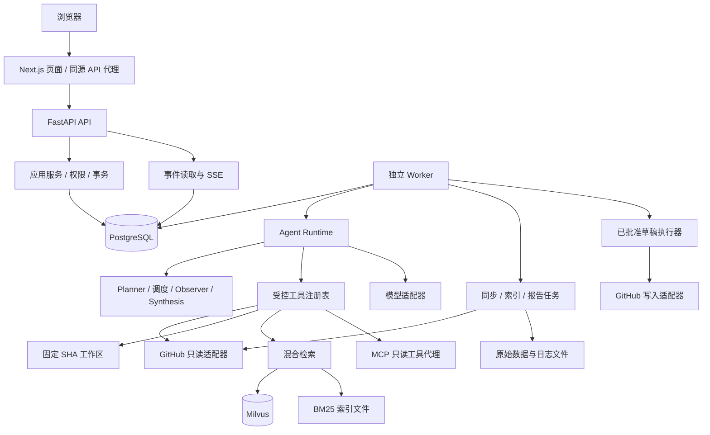

# DevFlow AI：多智能体研发协作助手

> 自主实现版 · M0–M7 学习版实现与验收 · 2026-10-15
>
> **已实现：** 登录与仓库隔离、GitHub 增量同步、固定 SHA 证据、PR/Issue/CI/健康检查/知识问答、LangGraph 发布检查、共享预算与节点恢复、知识库与 BM25/可选向量检索、项目记忆审批、活动报告、版本绑定的操作草稿、审计、只读 MCP 和声明式 Skill。
>
> **开始使用：** [启动与日常操作](docs/development.md)；[项目流程详解](docs/project-process.md) 说明组件职责、端到端链路、边界与验收方式。浏览器进入仓库后，可使用「新建分析会话」「知识库」「工作流与审批」。真实模型需要本地 `.env`；密钥不进入代码仓库。
>
> **验收与边界：** [M4–M7 验收记录](docs/demos/platform-acceptance.md)、[40 例确定性回归结果](evals/results/offline-latest.json)。真实 Issue、CI 与 PR 发布检查已运行；CI 日志无权限时保留未知。外部写入默认关闭，真实写回未执行；可选 Milvus/embedding 与第三方 MCP 需另行配置。离线边界通过不代表模型质量或生产性能承诺。
>
> 下文保留完整设计契约；具体交付实现、受控简化与外部依赖边界以验收记录和 `contracts/openapi.json` 为准。历史阶段记录：[M0](docs/demos/m0-acceptance.md)、[M1](docs/demos/m1-acceptance.md)、[M2](docs/demos/m2-acceptance.md)、[M3](docs/demos/m3-acceptance.md)。
> 工作流恢复、计划约束与写回边界的实现决策见 [ADR 0006](docs/adr/0006-platform-workflows-and-write-boundaries.md)。截至 2026-10-16：后端 255 项、浏览器 13 项、固定评测 40 项通过；首轮还完成了独立 Docker 安装和备份恢复。
>
> 项目依据已阅读的小林 coding DevFlow AI 介绍文章独立实现，不表示取得原项目源码。

> **2026-10-16 改进：** 已建立 [真实案例评测基线](evals/README.md)，增加按提交 SHA 获取 CI、GitHub 权限诊断、PR/Issue/CI/来源证据选择器，以及审批、取消、租约恢复的独立浏览器流程。详见 [本轮实现与验收](docs/demos/improvements-20261016.md)。真实基线的来源复核初稿发现旧输出的事实与引用问题，未将功能测试通过率当作模型准确率。

## 目录

- [01 项目定位与范围](#s01)
- [02 核心设计决策](#s02)
- [03 系统架构与部署边界](#s03)
- [04 完整目录与文件职责](#s04)
- [05 模块依赖与内部接口](#s05)
- [06 全局数据契约](#s06)
- [07 数据库、文件与索引设计](#s07)
- [08 仓库接入与同步](#s08)
- [09 代码工作区与证据](#s09)
- [10 模型适配与单 Agent Loop](#s10)
- [11 各业务功能的实现细节](#s11)
- [12 多 Agent 工作流](#s12)
- [13 知识库与混合检索](#s13)
- [14 上下文与长期记忆](#s14)
- [15 操作草稿、权限与审计](#s15)
- [16 MCP 与 Skill 扩展](#s16)
- [17 后台任务、恢复与取消](#s17)
- [18 API 契约与错误语义](#s18)
- [19 SSE 流式事件](#s19)
- [20 前端页面、交互与状态](#s20)
- [21 配置、部署与运维](#s21)
- [22 测试、评测与验收矩阵](#s22)
- [23 开发顺序与完成标准](#s23)
- [24 设计边界、待验证项与参考](#s24)

<a id="s01"></a>
## 01 项目定位与范围

### 1.1 产品目标

面向一个 GitHub 仓库提供研发分析：收集 Issue、PR、Review、CI、代码和项目文档，使用模型与工具形成有来源的结论，并保存执行过程以便核查。

典型问题：

- “这个 PR 改了什么，有哪些风险，还缺哪些验证？”
- “这次 CI 失败更像代码问题还是环境问题？”
- “这个 Issue 应如何分类、排优先级、拆出行动项？”
- “当前候选版本有哪些阻塞项，是否建议发布？”
- “上周完成了什么，还有哪些事项没有闭环？”

工程师保留合并、发布、关闭问题等最终决策权。分析报告中的建议与 GitHub 的实际合并权限、保护规则是不同概念。

### 1.2 版本范围

| 阶段 | 纳入范围 | 暂不纳入 |
| --- | --- | --- |
| MVP（M0–M2） | 单用户、本地部署；可配置多个仓库但每个会话绑定一个仓库；GitHub 只读；PR 分析；代码取证；SSE；轨迹 | RAG、多 Agent、外部写入、远程公网部署 |
| 完整学习版（M3–M7） | 历史知识检索；Issue/CI Agent；协作分析；记忆审批；周报；操作草稿；MCP/Skill；评测 | 多租户 SaaS、计费、组织 SSO、企业高可用 |
| 后续独立需求 | 多用户、GitHub App、Webhook、定时任务、GitHub Enterprise | 不因目录预留而默认实现 |

首版 GitHub 来源仅支持 `github.com` 与其官方 API，不开放任意 Git URL、任意 HTTP 抓取或用户传入本机目录。

### 1.3 明确不做的功能

- 不自动改业务代码、执行目标仓库代码、安装其依赖或运行 CI 脚本。
- 不自动合并 PR、推送 Git、发布版本、部署应用或删除远端资源。
- 不把“未发现风险”表述为“没有风险”，不把 CI 成功表述为代码质量保证。
- 不承诺从不完整日志定位唯一根因，不把模型自报置信度当统计概率。
- 不复制文章付费资料；不将原文的课程学习周期当作独立开发工期。

### 1.4 各功能统一完成条件

每项功能必须同时具备输入校验、仓库授权、结构化输出、证据引用、缺失数据说明、可追踪运行和至少一个异常路径验证。只展示一段模型文字不算完成。

<a id="s02"></a>
## 02 核心设计决策

| 编号 | 决策 | 原因与边界 |
| --- | --- | --- |
| D01 | 模块化单体，API 和 Worker 两个进程 | 模块可单测且部署简单；暂不拆微服务 |
| D02 | PostgreSQL 是业务状态的唯一权威来源 | Milvus、关键词索引、SSE 都是派生视图，不能决定权限或审批状态 |
| D03 | 长任务进入持久化 Job 队列 | HTTP 返回后任务继续；不依靠内存 BackgroundTasks 保证恢复 |
| D04 | 首个 Agent Loop 手写；复杂编排接入 LangGraph | 先掌握工具循环；框架不得接管未经定义的写权限或无界循环 |
| D05 | 当前代码固定 commit，实时状态带采集时间 | 避免不同版本的代码、CI 和 PR 结论混用 |
| D06 | 工具由服务端注入仓库范围和权限 | 模型参数不能选择凭据、扩大目录或切换授权身份 |
| D07 | 全部结论通过结构化结果生成展示文本 | 证据 ID 校验后才渲染真实链接；未知信息可以显式为空 |
| D08 | RAG 初版采用 Milvus 稠密召回 + 本地 BM25 索引 | 适用于学习版规模；扩大规模再替换关键词实现 |
| D09 | PostgreSQL Outbox 驱动索引更新 | 数据库与向量库之间没有跨库事务，必须管理一致性 |
| D10 | 外部写入只走 ActionDraft | 生成、批准、执行分离；未知执行结果不能盲目重试 |
| D11 | 每个会话同一时刻仅一个活动分析 Run | 保证消息顺序、摘要边界和上下文可重复 |
| D12 | SSE 展示安全的执行摘要 | 不展示模型私有推理链、密钥或未脱敏原始日志 |

**选型基线：** Python + FastAPI + Pydantic + SQLAlchemy/Alembic；Next.js + React + TypeScript；PostgreSQL；Milvus；Docker Compose。LangChain 仅放在适配层，不让框架类型侵入业务契约。Python/Node、数据库和库版本在 M0 兼容性验证后固定，不使用浮动 `latest`。

LangGraph 提供有状态工作流能力，但不代替本项目的 Job 租约、业务状态机与幂等设计。[官方说明](https://docs.langchain.com/oss/python/langgraph/overview)

<a id="s03"></a>
## 03 系统架构与部署边界



### 3.1 进程职责

| 进程/组件 | 承担工作 | 禁止承担 |
| --- | --- | --- |
| Web | 页面、会话交互、SSE 客户端、展示 | 保存服务端密钥、直接访问数据库/GitHub 私有凭据 |
| API | 认证、校验、创建 Job、查询、事件订阅 | 在请求事务中长时间调用模型或执行完整工作流 |
| Worker | 同步、分析、索引、报告、草稿执行 | 绕过授权、将远端写入当普通可重试 Job |
| PostgreSQL | 状态、关系、事件、队列、审计 | 储存无上限原始大日志 |
| Milvus/BM25 | 以片段 ID 返回候选 | 自行决定用户能否读取候选内容 |
| 文件存储 | 日志、快照、索引、Git 对象 | 作为权限真相来源或公开静态目录 |

### 3.2 一次 PR 分析的端到端链路

1. API 校验登录身份、会话仓库、PR 编号和输入长度。
2. 同一事务创建用户消息、Run、Job、`run.queued` 事件，返回 `202`。
3. Worker 领取 Job，刷新 PR 元数据并固定 base/head SHA，建立本次取证范围。
4. 读取 diff、Review、关联 Issue、匹配 head SHA 的 CI 信息；按需读取代码。
5. Agent 分析并引用已经持久化的 Evidence；超出预算时提前收束。
6. 后端校验输出 Schema、引用归属和规则，重新核对 PR head；变更则标记报告过时。
7. 同一事务写入最终结果、助手消息、Run 终态和终态事件。
8. 前端收到事件后拉取权威结果；刷新页面也能恢复查看。

一次运行不是外部系统的原子快照：采集窗口内 GitHub 状态可能变化。报告保存 `collection_started_at`、`collection_finished_at` 和每条证据的 `observed_at`。

<a id="s04"></a>
## 04 完整目录与文件职责

以下是**完整目标目录**，按里程碑创建。M0 已建立实际使用的部分，其余不预建空壳文件；真实文件以仓库内容为准。M0 领域契约暂集中在 `domain/contracts.py`，ORM 暂集中在 `persistence/models.py`，HTTP 路由暂集中在 `main.py`，待 M1/M2 增长后按下面的职责拆分。

M0 另有 `scripts/init_env.py`、`scripts/start_local.ps1`、`scripts/stop_local.ps1`、`scripts/dev.ps1`，用于实际配置与本地进程管理；`contracts/domain-schemas.json` 是领域类型的自动导出。阶段性实现边界见 [ADR 0001](docs/adr/0001-m0-diagnostics.md)。

### 4.1 仓库根目录

```text
vibe/
├── README.md                         # 设计基线、开发入口与完成状态
├── .env.example                      # 变量名及无密钥示例，M0 创建
├── .gitignore                        # 忽略密钥、数据、索引、缓存与输出
├── backend/                          # Python 服务和 Worker
├── frontend/                         # Web 应用
├── contracts/
│   ├── openapi.json                  # 从后端生成，不手工维护重复契约
│   └── examples/                     # 请求/事件/结果的脱敏 JSON 样例
├── evals/
│   ├── datasets/                     # 版本化问题、标注、工具与证据
│   ├── configs/                      # 模型/Prompt/检索实验组合
│   ├── scorers/                      # 检索、引用、工作流评分入口
│   └── README.md                     # 数据来源、运行方式与解释口径
├── fixtures/
│   ├── github/                       # 脱敏 API 回放数据
│   ├── repositories/                 # 人工构造的最小 Git 仓库
│   ├── documents/                    # 检索/编码/注入测试文档
│   └── logs/                         # 已分类 CI 日志片段
├── infra/
│   ├── compose.yaml                  # 基础服务与 knowledge 可选 profile
│   ├── docker/                       # API、Worker、Web 的 Dockerfile
│   └── proxy/                        # 同源转发、SSE 不缓冲配置
├── scripts/
│   ├── export_contracts.py           # 导出 OpenAPI/示例
│   ├── seed_demo.py                  # 可重复导入演示数据
│   ├── run_eval.py                   # 显式触发评测，不随服务启动
│   └── check_architecture.py         # 模块依赖边界检查
├── docs/
│   ├── adr/                          # 重大决策的原因与变更
│   ├── runbooks/                     # 同步失败、索引恢复、未知写入结果
│   └── demos/                        # 验收步骤与真实运行记录
└── var/                              # 本地运行数据，不提交 Git
    ├── objects/                      # 日志/快照，按仓库与 hash 分区
    ├── workspaces/                   # Git 对象与固定 SHA 工作区
    ├── indexes/                      # BM25 的不可变 generation
    ├── exports/                      # 报告与评测导出
    └── tmp/                          # 有配额与 TTL 的中间文件
```

### 4.2 后端目录

```text
backend/
├── pyproject.toml / uv.lock          # 配置与锁定依赖
├── alembic.ini
├── migrations/versions/             # 版本化数据库迁移
├── app/
│   ├── main.py                      # FastAPI 生命周期、路由、异常处理
│   ├── bootstrap.py                 # 依赖装配；唯一了解所有实现的模块
│   ├── worker.py                    # 独立 Worker 进程入口
│   ├── api/
│   │   ├── deps.py                  # 身份、仓库范围、事务依赖
│   │   ├── errors.py                # DomainError → HTTP 映射
│   │   ├── sse.py                   # 事件序号、心跳与重连
│   │   └── routes/
│   │       ├── auth.py / settings.py
│   │       ├── repositories.py / sync.py
│   │       ├── conversations.py / runs.py
│   │       ├── evidence.py / knowledge.py
│   │       ├── memories.py / drafts.py
│   │       └── reports.py / evaluations.py / health.py
│   ├── core/
│   │   ├── config.py                # 环境变量解析、启动校验
│   │   ├── errors.py                # 稳定错误码，不包含密钥
│   │   ├── ids.py / clock.py         # ID 与 UTC 时间抽象
│   │   ├── logging.py / redaction.py # 结构化日志与脱敏
│   │   └── telemetry.py             # trace_id、指标、耗时
│   ├── domain/
│   │   ├── enums.py                 # Run/Task/Draft 状态等共享枚举
│   │   ├── scope.py                 # Actor、RepoScope、ExecutionContext
│   │   ├── evidence.py / analysis.py # 证据、分析结果和业务约束
│   │   ├── policies.py              # 新鲜度、覆盖率、风险裁决规则
│   │   └── ports.py                 # 模型/检索/存储/GitHub 的协议
│   ├── schemas/
│   │   ├── common.py                # 分页、错误、来源元数据
│   │   ├── requests.py / responses.py
│   │   ├── tools.py / events.py
│   │   └── agent_outputs.py         # Issue/PR/CI/计划的输出 Schema
│   ├── services/
│   │   ├── auth_service.py / repo_service.py
│   │   ├── sync_service.py / run_service.py
│   │   ├── knowledge_service.py / evidence_service.py
│   │   ├── memory_service.py / draft_service.py
│   │   ├── report_service.py / eval_service.py
│   │   └── unit_of_work.py          # 事务、事件与 Job 原子写入
│   ├── persistence/
│   │   ├── database.py              # Engine、Session 工厂
│   │   ├── models/                  # 按身份/仓库/知识/运行/安全分组 ORM
│   │   └── repositories/            # 必须带 scope 的查询与持久化
│   ├── jobs/
│   │   ├── queue.py / leases.py     # 领取、续租、fencing、重试
│   │   ├── dispatcher.py            # kind → handler 映射
│   │   ├── handlers/                # sync/analyze/index/report/action/eval
│   │   └── recovery.py              # 失效租约、续跑与未知写入核查
│   ├── integrations/
│   │   ├── github/
│   │   │   ├── client.py            # HTTP、分页、条件请求、限流
│   │   │   ├── read_adapter.py      # 外部读取；字段标准化
│   │   │   ├── write_adapter.py     # 仅供草稿执行器调用
│   │   │   └── credentials.py       # credential_ref → 服务端凭据
│   │   ├── llm/
│   │   │   ├── protocol.py / adapter.py
│   │   │   └── capabilities.py      # Tool Calling/结构化输出能力探测
│   │   └── mcp/client.py            # 白名单内的 MCP 会话
│   ├── ingestion/
│   │   ├── github_sync.py           # 按资源同步、重叠窗口与游标
│   │   ├── normalizers.py           # 外部数据 → 内部类型
│   │   ├── document_parser.py       # Markdown/纯文本解析
│   │   └── index_outbox.py          # 索引任务可靠投递
│   ├── workspace/
│   │   ├── manager.py               # Git 获取、租约、固定 commit
│   │   ├── reader.py / search.py     # 只读文件与受限搜索
│   │   └── path_policy.py           # 路径、链接、大小与类型边界
│   ├── tools/
│   │   ├── registry.py / executor.py # 工具元信息、校验与预算
│   │   ├── github_tools.py / workspace_tools.py
│   │   └── knowledge_tools.py / draft_tools.py
│   ├── agents/
│   │   ├── runtime.py / budget.py    # Loop、去重、结构校验、用量记录
│   │   ├── chat.py / issue.py / pr_review.py / ci_debug.py
│   │   └── prompts/                 # 按用途和版本保存模板
│   ├── workflows/
│   │   ├── state.py / graph.py       # LangGraph 状态映射与图装配
│   │   ├── planner.py / scheduler.py
│   │   ├── observer.py / synthesis.py
│   │   └── validators.py            # DAG、scope、任务数和依赖校验
│   ├── rag/
│   │   ├── chunker.py / embeddings.py
│   │   ├── vector_store.py / bm25_store.py
│   │   ├── retriever.py / fusion.py / reranker.py
│   │   └── index_manager.py         # generation 构建、切换、回收
│   ├── context/
│   │   ├── assembler.py / budgeter.py
│   │   └── summarizer.py            # 会话摘要，不生成权威事实
│   ├── memory/
│   │   ├── extractor.py / policy.py
│   │   └── recall.py                # 只召回已批准且适用的记忆
│   ├── safety/
│   │   ├── authorization.py         # 身份、角色、仓库权限
│   │   ├── draft_executor.py        # 批准状态、版本、远端前置条件
│   │   ├── reconciliation.py        # unknown 执行结果核查
│   │   └── audit.py                 # 审计追加记录
│   ├── skills/
│   │   ├── loader.py / validator.py / runtime.py
│   │   └── definitions/             # 声明式流程，无任意脚本
│   ├── reports/builder.py           # 周报聚合与引用校验
│   ├── evaluation/harness.py        # 回放、评分、差异报告
│   └── storage/local.py             # 受控对象存取、原子落盘、配额
└── tests/
    ├── unit/                        # 策略、切分、状态机
    ├── integration/                 # PostgreSQL、Git、索引、事务
    ├── contract/                    # HTTP、SSE、工具、模型 Schema
    ├── security/                    # 跨仓库、注入、路径与审批
    └── replay/                      # 脱敏 GitHub/模型响应回放
```

### 4.3 前端目录

```text
frontend/
├── package.json / pnpm-lock.yaml
├── src/
│   ├── app/
│   │   ├── layout.tsx / page.tsx
│   │   ├── login/page.tsx
│   │   ├── settings/page.tsx
│   │   ├── repos/page.tsx
│   │   └── repos/[repoId]/
│   │       ├── layout.tsx / page.tsx         # 仓库概览
│   │       ├── conversations/[id]/page.tsx  # 聊天与任务启动
│   │       ├── runs/[runId]/page.tsx        # 独立运行详情
│   │       ├── knowledge/page.tsx
│   │       ├── memories/page.tsx
│   │       ├── drafts/page.tsx
│   │       ├── reports/page.tsx
│   │       └── evaluations/page.tsx
│   ├── features/
│   │   ├── repositories/           # 仓库选择、同步进度、健康摘要
│   │   ├── chat/                   # 输入、消息、取消、运行绑定
│   │   ├── runs/                   # 任务图、工具轨迹、终态
│   │   ├── evidence/               # 引用、版本/时间、片段查看
│   │   ├── knowledge/ / memories/  # 索引状态、批准/拒绝/撤销
│   │   ├── drafts/                 # 预览、确认、执行、未知状态
│   │   ├── reports/ / evaluations/
│   ├── components/ui/              # 通用控件，不调用领域 API
│   ├── lib/
│   │   ├── api/client.ts           # HTTP、错误、幂等键
│   │   ├── api/generated.ts        # 从 OpenAPI 生成类型
│   │   ├── sse/client.ts           # 重连、游标、去重、解析
│   │   └── markdown.ts             # 安全 Markdown 渲染
│   ├── hooks/                      # 与业务无关的 UI hooks
│   └── styles/
└── tests/
    ├── components/                 # 状态与关键组件
    └── e2e/                        # 登录、分析、重连、审批
```

### 4.4 目录维护规则

- 路由只做协议处理，不把 Prompt、SQL、Git 操作写进路由。
- `services/` 编排业务事务；业务规则落在 `domain/` 或专属模块。
- 工具不得直接创建第二套身份、数据库连接或写入路径。
- `schemas/` 是外部契约，ORM 对象不直接返回前端或模型。
- Prompt、Skill 和评测数据版本化；真实私有仓库资料不提交 Git。
- 不建立无归属的 `utils.py` 大杂烩；按职责组织功能。

<a id="s05"></a>
## 05 模块依赖与内部接口

依赖方向：`api/jobs → services → domain + 各业务模块 → ports`；`integrations/persistence/storage` 实现 ports；`bootstrap.py` 装配。业务模块不反向 import 路由，Agent 不直接 import ORM 或 GitHub 写适配器。

| 接口草案 | 输入 → 输出 | 负责模块 | 边界 |
| --- | --- | --- | --- |
| `RepositoryService.register` | Actor + repo full name → Repository | services | 验证可访问性，不接受任意 URL |
| `SyncService.enqueue` | RepoScope + options → SyncRun | services/ingestion | 同仓库同资源串行，不阻塞 HTTP |
| `RunService.submit` | Actor + conversation + request → Run | services | 原子创建消息、Run、Job、事件 |
| `ModelPort.complete` | request + budget → reply + usage | integrations/llm | 不执行模型返回的工具 |
| `ToolExecutor.execute` | ExecutionContext + request → ToolResult | tools | 授权、参数、超时与追踪统一处理 |
| `WorkspacePort.read` | RepoScope + SHA + path → FileSlice | workspace | 无工作区外读取、无任意命令 |
| `EvidenceService.capture` | scope + source + content → EvidenceRef | services | 不可变快照，服务端规范化来源 |
| `RetrievalPort.search` | scope + query + filters → RetrievalResult | rag | 固定 generation、过滤与来源回查 |
| `WorkflowRunner.run` | context + validated plan → AnalysisResult | workflows | 整个工作流共享总预算 |
| `DraftService.approve` | Actor + ID + version/hash → Draft | services/safety | 精确绑定审批对象，模型不能批准 |
| `DraftExecutor.execute` | approved draft ID → ExecutionResult | safety | 唯一外部写入入口，重新授权 |

外部 SDK 异常在适配器层转为稳定 `DomainError`。在 API/Worker 最外层记录一次完整错误轨迹，避免各层重复记录敏感请求体。

<a id="s06"></a>
## 06 全局数据契约

### 6.1 通用约定

- 内部 ID 使用 UUID；外部 GitHub ID 单独保存，不以仓库名或 Issue 编号当全局 ID。
- 时间存 UTC、传 ISO 8601；界面按用户时区展示，默认 `Asia/Shanghai`。
- `repo_id` 必须从已授权会话/资源解析，不信任模型提供的同名字段。
- 所有核心 JSON 含 `schema_version`；破坏性变更升级 `/api/v1` 或相应 Schema 版本。
- 原文内容、模型建议、规则判断分别存储；空值与“未查询”“无权限”“确实不存在”区分。
- 定量指标同时保存分子、分母、时间窗口与覆盖度，不单独保存一个百分比。

### 6.2 执行上下文 ExecutionContext

```text
actor_id, repo_id, conversation_id?, run_id, task_run_id?,
credential_ref, target {pr_number?, base_sha?, head_sha?, ci_run_id?},
deadline_at, budget_id, cancel_token,
prompt_version, toolset_version, config_snapshot_id, lease_epoch
```

该对象由服务端构造，工具只获得必要字段。模型可以请求 PR 编号等业务参数，不能改写 `actor_id`、凭据、工作区根路径、租约或预算。

### 6.3 统一工具返回 ToolResult

```json
{
  "schema_version": "1.0",
  "status": "partial",
  "data": {"pr_number": 42, "head_sha": "example-sha"},
  "evidence_ids": ["00000000-0000-4000-8000-000000000101"],
  "warnings": ["PATCH_TRUNCATED"],
  "error": null,
  "meta": {
    "source": "github",
    "observed_at": "2026-10-08T06:00:00Z",
    "freshness": "fresh",
    "truncated": true,
    "next_cursor": null
  }
}
```

以上只是契约示例，不代表真实 PR。`status = ok | partial | error`；错误含 `code/message/retryable`，不得带请求密钥或外部原始异常。分页读取中 `next_cursor` 是受控游标，不是可由模型访问的任意 URL。

`freshness = fresh | stale | unknown` 是相对当前配置的采集新鲜度；固定 commit 的代码内容不可变，但所属 PR 是否仍指向该 commit 需要另行检查。

### 6.4 通用分析结果 AnalysisResult

| 字段 | 类型/取值 | 语义 |
| --- | --- | --- |
| `kind` | repo_health / issue_triage / pr_review / ci_debug / release_check / knowledge_qa / weekly_report | 业务类型 |
| `summary` | string | 可展示摘要，不含未经验证的链接 |
| `verdict` | recommend_merge / hold / insufficient_evidence / recommend_release / not_applicable | 分析建议；依业务类型限制枚举 |
| `coverage` | complete / partial / unavailable | 对本次声明分析范围的数据覆盖度，不代表全仓库无缺陷 |
| `freshness` | fresh / stale / unknown | 最后刷新状态；历史报告的相对新鲜度在读取时重算 |
| `findings[]` | severity、claim、evidence_ids、location、suggestion | 可核查发现；severity 为 critical/high/medium/low/info |
| `hypotheses[]` | claim、supporting_evidence_ids、counter_evidence_ids、verification_steps | 尚未证实的根因或推测 |
| `missing_evidence[]` | item、reason、impact、next_action | 证据缺口及影响 |
| `next_actions[]` | description、owner_hint?、draft_id? | 建议不等于已执行 |
| `scope` | repo_id、target、时间窗口、snapshot/generation | 结论适用范围 |
| `limitations[]` | string | 截断、缺权限、过时、预算结束等限制 |

专用 Agent 在公共字段上增加业务字段。`verdict` 可用范围：PR 为 merge/hold/insufficient；发布为 release/hold/insufficient；其余为 not_applicable。规则校验器可以降级模型建议，但不能伪造模型没有发现的证据。

### 6.5 状态与结论必须分离

- `Run.status = completed`：过程结束且有合规结果；结果仍可为 `insufficient_evidence`。
- `Run.status = failed`：系统没有产出合规最终结果；可能保留部分工具轨迹。
- `coverage = partial`：有内容未读取；不等同于 Run 失败。
- `freshness = stale`：对应远端版本/状态已变化或采集时间超阈值；不改写历史证据。

<a id="s07"></a>
## 07 数据库、文件与索引设计

### 7.1 关系模型

所有业务表默认含 UUID `id`、`created_at`；可变表增加 `updated_at`、整数 `version`。时间采用 `timestamptz`，枚举使用受约束字符串。结构化大结果用版本化 JSONB，但重要查询字段独立列。

| 表/实体 | 核心字段 | 唯一键/索引与规则 |
| --- | --- | --- |
| `users` | username、password_hash、disabled | username 唯一；MVP 仅引导创建一个管理员 |
| `sessions` | user_id、token_hash、expires_at | token_hash 唯一；只存会话令牌 hash |
| `repositories` | provider、external_id、full_name、credential_ref、state、config_json | `(provider, external_id)` 唯一；改名不建新仓库 |
| `repo_memberships` | user_id、repo_id、role | `(user_id, repo_id)` 唯一；初版自动授权管理员 |
| `sync_runs` | repo_id、resources、status、started_at、counts、errors | `(repo_id, created_at)`；同资源只允许一个活动同步 |
| `sync_cursors` | repo_id、resource、committed_watermark、etag、coverage | `(repo_id, resource)` 唯一；完成一个资源后才前移 |
| `issues` | repo_id、external_id、number、state、title、body_ref、source_updated_at | `(repo_id, number)`、`(repo_id, external_id)` 各唯一 |
| `pull_requests` | repo_id、external_id、number、base_sha、head_sha、state、merged_at | 同上；不与 issues 混合计数 |
| `reviews` | repo_id、pr_id、external_id、state、commit_sha、submitted_at | `(repo_id, external_id)`；保留被撤销状态 |
| `ci_runs` / `ci_jobs` | repo_id、external_id、attempt、head_sha、status、conclusion、logs_ref | `(repo_id, external_id, attempt)`；job 增加 run_id 外键 |
| `activity_events` | repo_id、source_event_id、kind、occurred_at、actor、subject、evidence_id | `(repo_id, source_event_id)`；用于周报，不能只依赖最新快照 |
| `source_snapshots` | repo_id、source_type、external_id、revision、observed_at、object_ref、content_hash | 内容不可变；相同内容可共用对象文件 |
| `documents` | repo_id、source_key、origin、current_version_id、state | `(repo_id, source_key)`；origin=source/generated |
| `document_versions` | document_id、repo_id、content_hash、source_revision、parser_version、object_ref | `(document_id, content_hash, parser_version)` |
| `chunks` | repo_id、document_version_id、ordinal、heading_path、text、content_hash | `(document_version_id, ordinal)`；保留行区间 |
| `index_generations` | repo_id、status、embedding_config、bm25_manifest、source_manifest_hash | 一个仓库仅一个 active generation |
| `index_memberships` | generation_id、chunk_id、repo_id | `(generation_id, chunk_id)`；检索回查是否属于本代 |
| `index_outbox` | repo_id、entity_id、event_type、payload、status | 写文档和 Outbox 同事务；投递可重复、消费幂等 |
| `evidence` | repo_id、snapshot_id?、chunk_id?、source_type、locator、excerpt、hash、observed_at | 不可变，locator 保存 SHA/路径/行号/job 等 |
| `run_evidence` | run_id、evidence_id、task_run_id?、usage | `(run_id, evidence_id, usage)`；限制模型引用范围 |
| `conversations` / `messages` | repo_id、owner_id、conversation_id、seq、role、content、run_id? | message 的 `(conversation_id, seq)` 唯一；消息序号由服务端分配 |
| `conversation_summaries` | conversation_id、through_seq、source_hash、summary、prompt_version | 不覆盖原始消息；与摘要覆盖范围绑定 |
| `runs` | repo_id、conversation_id?、kind、status、target、result、budget、config_snapshot、cancel_requested_at | 会话非终态 Run 的部分唯一索引；后台 Run 可无会话 |
| `agent_runs` / `tool_calls` | run_id、task_id?、agent、model、input_hash、status、usage、error | 工具另存 logical_call_id、attempt、result_ref；避免丢失重试成本 |
| `workflow_runs` / `task_runs` | run_id、plan_version、task_key、dependencies、state、output_ref | `(workflow_run_id, plan_version, task_key)` 唯一 |
| `run_events` | run_id、seq、type、payload、created_at | `(run_id, seq)` 唯一且递增；与状态变更同事务 |
| `jobs` | kind、entity_id、status、available_at、lease_owner、lease_epoch、lease_until、attempt | 队列索引 `(status, available_at)`；活动 kind/entity 去重 |
| `resource_leases` | repo_id、resource_kind、resource_key、owner、epoch、expires_at | 同步范围、工作区与索引代的在用标记；清理前检查 |
| `config_snapshots` | config_hash、effective_json、version_refs | config_hash 唯一；不含密钥，Run 引用不可变快照 |
| `budget_accounts` / `budget_reservations` | run_id、limit、consumed、reserved；call_id、reserved_tokens、actual_tokens、state | run_id/call_id 分别唯一；原子预留和幂等结算 |
| `memory_candidates` / `memories` | repo_id、statement、evidence_ids、applicability、status、expires_at、reviewer_id | 批准候选后创建版本化记忆；hash 用于候选去重 |
| `action_drafts` | repo_id、creator_id、action、target、payload、payload_hash、status、version、expires_at | 批准绑定版本与 hash；内容变更生成新版本 |
| `action_draft_versions` | draft_id、version、payload、payload_hash、state、approval_metadata | `(draft_id, version)` 唯一；保留旧内容与批准，不覆盖历史 |
| `action_executions` | draft_id、approved_version、attempt_id、state、remote_id、request_hash、error | `(draft_id, approved_version)` 唯一；同版本最多一条逻辑执行 |
| `audit_logs` | actor_id、repo_id、action、subject_id、before_hash、after_hash、outcome、trace_id | 应用只追加；不存 Token，非防篡改存储承诺 |
| `reports` | repo_id、run_id、period_start/end、timezone、revision、result | `(repo_id, period_start, period_end, revision)`；旧版不覆盖 |
| `eval_runs` / `eval_cases` | dataset_version、config_hash、code_sha、metrics、result_refs | 按数据集与配置比较，保留逐题分数 |
| `idempotency_records` | actor_id、route、key、request_hash、resource_id、expires_at | `(actor_id, route, key)` 唯一；同键不同 body 拒绝 |

外键落到仓库资源时尽量使用 `(repo_id, id)` 组合约束，防止应用 bug 写出跨仓库关联。列表索引通常为 `(repo_id, created_at, id)` 或 `(repo_id, state, source_updated_at)`；不为每个 JSON 字段预建索引。

### 7.2 事务与不可变边界

- PR/Issue 表保存最新视图；报告引用 `source_snapshots/evidence` 中的历史版本。
- Run 创建、消息写入、Job 入队和事件发布在一个数据库事务完成。
- 工具网络调用、模型调用、Git 操作不占用长事务；先提交执行意图，再执行，再提交结果。
- 行状态变更使用 `version` 或租约 epoch 条件更新，失败说明状态已被其他执行者改变。
- 事务回滚不意味着外部 HTTP 请求回滚；外部写入依靠第 15 节的核查机制。

### 7.3 文件对象与清理

路径采用服务端生成的 `repo_id/type/content_hash`，不使用用户上传文件名拼接真实路径。先写临时文件、校验大小/hash，再原子改名并提交数据库引用；无引用临时对象由 GC 清理。

初始保留策略：运行与证据元数据 90 天；原始日志 30 天；SSE 事件 7 天；临时文件 24 小时。被活动任务、保留报告或人工固定的证据引用的对象不能自动删除。显式删除源文档后先撤销检索资格，历史证据按引用策略保留并标记源已删除。

仓库“移除”先进入 disabled，禁止新任务；物理清理是独立维护动作，等待活动租约释放并检查所有对象的仓库归属。用户明确请求彻底删除时级联清理业务内容、索引与文件，审计仅保留不含内容的删除记录。

### 7.4 索引一致性

新增文档 → DB 版本与 Outbox → 构建 generation → 完成向量与 BM25 → 校验数量/hash → 原子切换 DB 的 active generation。

切换前查询旧代，失败时仍使用旧代并展示索引滞后。查询固定一个 generation；Milvus/BM25 结果均须回查 DB 的 membership、document 状态与权限。旧代保留至查询租约结束后回收。

<a id="s08"></a>
## 08 仓库接入与同步

### 8.1 仓库接入

**入口：** 用户输入 `owner/repo`，选择服务端已配置凭据引用。凭据值不由模型传入，初版不通过聊天录入 Token。

**步骤：** 校验格式 → 读取仓库元数据 → 验证可访问性 → 按 external ID 去重 → 保存默认分支与权限摘要 → 创建首轮同步任务。

同一个远端仓库换名只更新 `full_name`。认证失败不创建“成功连接”的记录。403/404 无法区分不存在与无权限时使用 `SOURCE_UNAVAILABLE`，不臆断远端资源已删除。

### 8.2 同步资源与范围

| 资源 | 首次默认范围 | 后续更新 | 不完整时处理 |
| --- | --- | --- | --- |
| Issue/PR | 所有 open + 最近 90 天有更新的 closed | since/updated 时间重叠窗口或端点支持的分页扫描 | 保存范围、页数和中断点，不显示全量总数 |
| Review/评论 | 当前分析对象与同步范围内对象 | 对更新对象重新读取 | 标记讨论覆盖不足 |
| CI | 最近 30 天运行摘要 | 按运行/attempt 更新 | 无权限显示 unknown，不当作没有失败 |
| CI 日志 | 分析指定失败 job 时按需下载 | 对新 attempt 重新下载 | 记录过期/不可访问，不用旧 attempt 代替 |
| 文档 | 用户选定路径下 Markdown/纯文本 | 按 commit 与内容 hash 更新 | 解析失败保留旧有效版本并标记过时 |
| 活动事件 | 可访问范围内的关闭、合并、Review 等 | 按外部事件 ID 幂等保存 | 历史事件覆盖不足时周报显示缺口 |

首轮设置资源上限，达到上限暂停并返回 `partial`，由用户显式扩大范围。列表 API 里的 PR 条目按类型分流，避免 Issue 数量重复。

### 8.3 增量与失败恢复

1. 领取 `(repo_id, resource)` 同步锁，记录本次开始时间与旧水位。
2. 默认回看旧水位前 5 分钟，缓解时间精度和更新延迟。
3. 逐页规范化、upsert 最新快照，保存不可变来源与本页检查点。
4. 只有该资源的计划范围完成，才将 committed watermark 推进到本次安全上界；失败重跑依靠外部 ID/hash 去重。
5. 不支持可靠 `since` 的端点使用完整有界扫描；不能把上一页游标当永不过期增量游标。
6. 周期性的手动全量核对用于发现删除/撤销；一次列表漏项不能证明对象已删除。

429/限流 403 按远端 `Retry-After` 或 reset 信息等待，其他权限 403 不当作限流重试。读取请求只对网络暂时失败及可恢复服务错误做退避重试；写请求不套用同一策略。分页和条件请求遵循 GitHub 官方建议。[API 实践](https://docs.github.com/en/rest/using-the-rest-api/best-practices-for-using-the-rest-api)

### 8.4 新鲜度规则

仓库概览默认 5 分钟内采集视为 fresh；超过阈值展示采集时间。PR 分析启动时强制读取目标 PR 与关联 CI 摘要；输出前再次检查 head SHA。最后检查失败标记 unknown，head 改变标记 stale，不能建议直接合入旧版本。

在两个检查点之间仍可能出现新的 Review 或 CI 状态；报告明确采集窗口，执行写操作时再校验与操作相关的前置条件。

<a id="s09"></a>
## 09 代码工作区与证据

### 9.1 固定版本代码读取

`WorkspaceManager` 以 `repo_id + commit_sha` 定位内容。优先使用受控 Git 对象读取指定 blob，必须落地时创建不可变工作区；不在分析过程中 checkout 可变分支。

获取来源只允许已登记仓库。PR 来自 fork 时，先尝试基础仓库公开的 PR ref；不可取得目标 SHA 时返回代码不可用，不自动克隆任意外部仓库。

不启用仓库 hooks、子模块、LFS 自动下载或过滤器，不执行仓库提供的脚本。Git 凭据通过安全的凭据机制提供，不拼进命令行 URL、日志或 `.git/config`。

### 9.2 文件与搜索工具

| 工具 | 输入 | 实现 | 限制与失败语义 |
| --- | --- | --- | --- |
| `read_file` | 相对路径、start_line、end_line | 校验路径后读取目标 SHA 文本 blob，返回原始行号 | 单文件 1 MiB；每次最多 400 行；二进制不读取 |
| `search_code` | query、path_glob?、cursor? | MVP 固定字符串搜索，文件与结果确定性排序 | query 256 字符；最多 100 命中；5 秒；首版不接受任意正则 |
| `get_pr_diff` | PR 编号、file_cursor? | 优先 API；可用时对固定 SHA 进行 Git diff | 文件清单/patch 不全时明确标记，不把缺 patch 当作无变更 |

路径拒绝绝对路径、盘符、UNC、`..` 越界、NUL、NTFS ADS。物理路径解析后必须位于受控根目录；符号链接和 Windows junction 首版不跟随。路径按仓库 Git 名称处理，避免 Windows 大小写折叠导致读取错误文件。

大 diff 默认最多分析 200 个文本文件、2 MiB 变更正文；优先认证/权限/配置/公共接口及用户指定路径，其余列出未审阅清单。二进制、生成文件、重命名分别报告；不将风险排序视为完整审查。

GitHub PR 文件列表存在端点返回限制，设计必须检测总数/分页与实际取得数量，不假设一页覆盖全部文件。[PR API 文档](https://docs.github.com/en/rest/pulls/pulls#list-pull-requests-files)

### 9.3 证据存储与引用校验

Evidence 至少包含：`id/repo_id/source_type/source_url/observed_at/content_hash/excerpt/truncated`，代码增加 commit/path/line，CI 增加 run/attempt/job/log offset。

所有引用在提交最终回答前做三层验证：

1. ID 存在、属于当前 repo、属于本次 Run 已收集的证据集合。
2. 文件行号/日志范围与保存的原始片段一致，链接由可信来源定位信息生成。
3. claim 是否被证据支持由规则、人工标注评测及可选评审模型检查；“ID 有效”本身不代表事实正确。

无法验证的发现退回一次受限修正；仍失败则删除无效引用，把未证实说法移入 hypotheses/limitations。PR/发布任务可降为 `insufficient_evidence`；其他类型通过 coverage 与 missing_evidence 表示缺口。任何最终字段都不能保留不存在/越权的引用 ID；不能仅换个字段名绕过校验。前端永不直接渲染模型生成的任意链接。

证据 UI 显示原始片段、来源、采集时间、版本和截断状态。源资源删除或无权限后，按当前仓库访问策略决定是否可查看已保存快照，不绕过权限展示缓存。

<a id="s10"></a>
## 10 模型适配与单 Agent Loop

### 10.1 模型适配

`ModelPort` 输入消息、工具 Schema、输出 Schema、deadline 和本次 Token 限额，输出 normalized reply、tool requests、finish_reason、usage、provider_request_id。提供商 SDK 的类型只存在于适配器。

在 M0 使用一个固定工具做能力探测：工具参数是否合法、工具结果能否继续对话、结构化输出如何验证、取消/超时如何返回。模型服务不兼容时给出配置错误，不在运行中偷偷换模型或改变调用协议。

usage 优先采用提供商返回值；没有时保存估算并标记 `estimated`。费用基于配置价格，不凭空声称精确金额。原始请求默认不完整记录，必要回放内容先脱敏。

### 10.2 Loop 执行算法

```text
load committed context and config snapshot
while budget/time/step limits permit:
    check cancellation, permissions and lease ownership
    assemble bounded context
    reserve shared model budget
    call model; persist reply metadata and usage
    if final structured response:
        validate schema, evidence and domain rules
        repair at most once within remaining budget
        finish with validated result or controlled failure
    else:
        validate tool names and arguments
        normalize args and check repeated-call policy
        execute permitted read tools with bounded concurrency
        persist ToolResult and evidence before next model call
if no final response:
    generate constrained partial result or deterministic budget-stop message
```

默认每次最多 8 次模型决策、12 次工具调用、3 个并发只读工具、180 秒总时间。结构修正最多 1 次且计入 8 次决策上限；工具错误重试也消耗总时间和调用预算。具体配置见第 21 节。

### 10.3 工具注册与重复调用

注册项包含 `name/version/input_schema/output_schema/effect/timeout/scope/cost_hint`。`effect = read | create_draft`；不向模型暴露直接写入 GitHub 的工具。

规范化参数与工具版本、repo、SHA、刷新模式构成调用 fingerprint。同一次运行中相同只读请求可返回已保存结果；同 fingerprint 连续重复两次且没有新增证据时返回 `REPEATED_TOOL_CALL` 并要求收束。实时状态明确请求刷新时允许重新读取，但仍受次数限制。

网络重试与 Agent 重新决策分开记录。未知工具、越权参数、无效 Schema 都返回稳定错误，不能自动映射到“最接近”的危险工具。

业务工具契约如下，通用包装都使用第 6 节 ToolResult，repo/actor/SHA 从 ExecutionContext 注入：

| 工具 | 模型可填写的参数 | data 的主要内容 | 前置能力/限制 |
| --- | --- | --- | --- |
| `get_repo_summary` | window_days、ref? | counts、采集时间、覆盖范围 | 默认读同步快照；不触发全仓库同步 |
| `list_issues` | state、labels?、cursor? | Issue 摘要与下一页游标 | 受控过滤、分页上限 |
| `get_issue` | issue_number | 描述、状态、讨论摘要、相关事件 | 模型不能选择凭据 |
| `list_pull_requests` | state、base?、cursor? | PR 摘要及 head | 不自动审查所有 PR |
| `get_pr` | pr_number | base/head、状态、描述、Review/检查摘要 | 目标与 context 一致；切换目标需新任务 |
| `get_pr_diff` | pr_number、file_cursor? | 文件列表、patch、coverage | 固定目标 SHA，预算外内容显式截断 |
| `get_ci_runs` | pr_number?、workflow? | 匹配目标 SHA 的 runs/attempt | 其他 SHA 只能作注明的对比证据 |
| `get_ci_logs` | ci_run_id、attempt、job_id? | 错误块、原日志偏移、缺失原因 | 验证 repo/目标归属，按需下载 |
| `read_file` | relative_path、start_line、end_line | 文本、行号、SHA | 第 9 节路径/大小规则 |
| `search_code` | query、path_glob?、cursor? | path/line/snippet 命中列表 | 固定字符串、限定范围 |
| `search_knowledge` | query、source_types?、date_range? | chunks、scores、generation、degraded | M3 才启用；不检索其他仓库 |
| `create_action_draft` | action、target、payload、evidence_ids | draft_id、version、pending 状态 | M6 才启用；仅本地草稿副作用 |

工具集按 Agent 缩减：PR Agent 读取 PR、代码、相关 Issue/CI；CI Agent 默认只读运行、日志、关联变更；Issue Agent 默认只读 Issue、代码与知识。Planner/Observer/Synthesis 不获得外部写能力。候选记忆由完成后的受控提取流程生成，不通过一般工具直接写入 active memory。

`create_action_draft` 使用稳定 logical_call_id 去重，重放只返回原草稿。生成草稿的工具不能套用普通只读缓存掩盖其副作用；可重放节点必须先查已提交记录。

### 10.4 Prompt 与输出责任

Prompt 分为系统规则、任务模板、证据包和输出 Schema；仓库文档/Issue/日志放入数据区。工具返回的“忽略之前指令”等文本不改变工具权限。

模型提出分析，后端执行规则判断。解析失败不能用正则截出任意一段 JSON 冒充成功；完成结果必须通过 Pydantic 与业务校验。

前端可展示“正在读取 PR”“日志不可用”等状态摘要；不要求模型输出逐步私有推理，也不将该内容写入轨迹。

<a id="s11"></a>
## 11 各业务功能的实现细节

### 11.1 仓库健康概览 Repo Health

**输入：** repo_id、统计窗口（默认最近 7 天）、目标分支。**入口：** 仓库首页；只读工具 `get_repo_summary`。

**处理：** 从已同步结构化数据计算 open Issue/PR、近期合并量、待 Review 项、失败 CI 列表；按 source freshness 标记每项指标。默认分支的每个 workflow/ref 取最新一次运行结果，防止某一个工作流的成功掩盖另一个工作流失败。

**输出：** `as_of/coverage/counts/blockers/warnings`，带可下钻列表。摘要由规则先生成事实表，模型只整理语言，不重新估算数字。

**边界：** 不做没有定义的“仓库健康 85 分”。同步不完整时数量标为“已同步范围内”，不能冒充远端总量；CI 未运行、无权限、取消和失败是不同状态。

**验收：** 固定数据集中的聚合数精确一致；移除 CI 权限后显示 unknown，不显示全部通过。

### 11.2 Issue 智能分诊

**输入：** issue_number，或明确标为“尚未发布”的标题和描述草稿；可选组件范围。**主要工具：** `get_issue/search_code/search_knowledge`。

**处理步骤：**

1. 区分 bug/feature/question/documentation/maintenance/unknown。
2. 提取实际现象、期望行为、复现条件、影响范围和缺失信息。
3. 搜索相关代码、相似历史问题；“相似”仅作为重复候选，不能自动关闭。
4. 根据已记录影响判定 P0–P3 或 unknown；复杂度为 small/medium/large/unknown，不承诺工时。
5. 负责人建议仅从可见 CODEOWNERS、配置的成员列表或可核查历史信息选择，提供依据；无依据则留空。
6. 形成下一步行动项与需要追问的问题。

**输出扩展：** `category/priority/priority_reason/complexity/owner_candidates/duplicate_candidates/reproduction/missing_fields/action_items`。

**边界：** 文本情绪和发帖者身份不能代替影响判断；版本不明时不猜受影响版本；只生成标签/回复建议，实际标签或评论走草稿流程。

**验收：** 信息不足样例优先给出澄清项；负责人均来自允许候选集；未确认时不发送任何评论。

### 11.3 PR 风险审查

**输入：** pr_number、可选重点路径。**必需来源：** PR 元数据、文件清单与 diff；代码、Issue、Review、CI 按可用性补充。

**处理步骤：**

1. 固定 PR base/head、采集时间与是否 draft；保存变更文件清单。
2. 解析增删行、重命名、二进制与 patch 缺失，选择在预算内可审查片段。
3. 按目录规则识别认证授权、密钥处理、数据库迁移、依赖、CI 配置、公共接口等重点；路径命中只是审查优先级，不直接等于漏洞。
4. 读取必要的调用处、类型定义与测试上下文，避免脱离上下文评价单行代码。
5. 检查关联需求与改动的一致性；读取匹配 head SHA 的 CI 与 Review 状态。
6. 生成逐条 finding：严重性、触发条件、影响、具体文件/行、证据和建议。
7. 应用规则得出建议，并在输出前复查 head。

**建议规则：**

| 条件 | verdict | 说明 |
| --- | --- | --- |
| 有可核查的阻塞缺陷、必需检查明确失败或已知合并冲突 | hold | 同时保留其他缺口，不被“信息不足”覆盖已有阻塞 |
| 无已确认阻塞，但关键 diff/代码/CI/保护规则信息不足 | insufficient_evidence | 缺项不能推断成通过 |
| 约定审查范围完整、当前 head 一致、相关必需检查通过、无未解决阻塞 | recommend_merge | 仅表示本次分析建议，实际仍服从 GitHub 与人工决策 |

必需检查优先来自可读取的仓库规则；读不到时使用管理员明确配置的本地检查清单并注明来源。两者都没有时只给范围内审查结论，不使用 recommend_merge。GitHub mergeable 暂未知、PR 为 draft、head 变化时不能给积极合入建议。

**边界：** 不自动提交 Review、不建议关闭未核查的讨论；缺失 patch、超过预算的文件和排除路径必须列出。行号基于固定 SHA 与 diff side，删除行不能错误链接到新文件行。

**验收：** 新提交使旧报告 stale；某个二进制/大文件未审查必须出现在遗漏清单；CI 通过但存在真实逻辑 bug 时仍能给 hold。

### 11.4 CI 智能排障

**输入：** ci_run_id + attempt，可选 job_id。默认定位指定 PR head 对应的最新 attempt；没有匹配运行就返回缺失。

**处理步骤：**

1. 区分 queued/in_progress/completed，保留 success/failure/cancelled/timed_out/skipped 等结论。
2. 先下载失败 job 日志；压缩包路径校验，流式解压，限制压缩后/解压后大小及单文件数量。
3. 去除 ANSI 控制序列和已识别密钥，保留原始行号映射、步骤名与时间。
4. 基于异常栈、失败测试、退出码和错误模式抓取候选块，默认上下各 30 行；避免只取最后一个 `exit code 1`。
5. 结合相关变更整理假设：代码/测试/依赖/环境/资源/未知；记录支持与反对证据。
6. 给出最小验证步骤和修复方向，不自动执行命令或重跑 CI。

**输出扩展：** `run/attempt/jobs/error_blocks/hypotheses/verification_steps/fix_suggestions`。

**边界：** 日志 404/过期/权限不足不等于无错误；失败测试不自动证明是本 PR 引入；单次失败不能确认 flaky，需要历史重复证据。基础分支运行只能作对比，不能替代 PR 检查。

**验收：** 区分测试断言失败与依赖下载失败；候选根因引用准确日志区间；超大日志被截断时说明分析窗口。

### 11.5 项目知识问答

**输入：** question、可选 source_type/日期范围。**路由：** 当前代码问题调用 Workspace；当前对象状态查 GitHub/快照；历史设计和讨论调用 RAG；混合问题组合取证。

**输出：** 简洁答案、事实引用、文档版本、相互冲突的说法和未找到的信息。历史文档提到的旧行为与当前代码不一致时以版本分别说明，不自动改写文档。

**边界：** 未检索到内容时返回证据不足；“模型知道某库怎么用”不能当作“该项目实际这样实现”。不跨仓库检索，也不自动联网搜索任意外部网页。

**验收：** 同名函数在不同仓库不串；只有过期文档时正确注明；回答中的每个项目事实有可追踪依据。

### 11.6 多 Agent 发布检查

**输入：** 候选 ref/SHA、发布范围（明确的 PR/Issue 列表或里程碑）及 release policy。没有明确范围时先要求补充，不默认把所有 open Issue 都当发布阻塞。

**处理：** 固定候选 SHA → 查询范围内仓库状态 → 按依赖安排 Issue/PR/CI 分析 → Observer 检查版本、证据和冲突 → 汇总阻塞项、非阻塞风险与缺项。

**输出：** `recommend_release/hold/insufficient_evidence`，列出适用候选版本与发布规则。参考链包含各子任务和证据。

**边界：** 不执行发布；仓库快照不包含线上监控、性能压测或人工 QA 时，明确列为未覆盖。没有 release policy 的结果只能说明已检查项，不能声称总体可发布。

**验收：** PR 检查对应其他 SHA 时 Observer 能发现；子任务失败或结论冲突不能被汇总文字抹掉。

### 11.7 研发周报

**输入：** repo_id、时区、`[period_start, period_end)`，默认用户时区上一个自然周；UI 展示准确起止时间后提交。

**处理：** 从活动事件聚合新增/关闭 Issue、合并 PR、Review 和 CI 变化，按稳定事件 ID 去重；用源数据计算数字，再由模型归类总结成果、风险和待办。历史事件采集不足则显示覆盖范围。

**输出：** 摘要、事实指标、代表性活动链接、阻塞事项、下周建议。生成报告存为不可变 revision；重新生成相同窗口产生新 revision，初版不提供任意正文编辑器。

**沉淀：** 用户选择“加入知识库”才入库，标记 `origin=generated`，保留底层 evidence_ids。默认权重低于源文档，不让多份周报互相引用形成事实循环。

**边界：** 首次同步的对象更新时间不能伪装为真实发生时间；不根据提交数量评价个人绩效；不自动发邮件/群消息；定时生成后续单独设计。

**验收：** 周日/周一边界和 UTC 转换正确；重跑相同窗口不重复计数；数字与事实表一致。

### 11.8 记忆与操作草稿入口

分析完成后可以产生“候选经验”与“建议操作草稿”，分别交给第 14、15 节的状态机。一个分析 Run 完成不代表记忆已批准或操作已执行；UI 用独立状态卡展示。

<a id="s12"></a>
## 12 多 Agent 工作流

### 12.1 计划结构

```json
{
  "schema_version": "1.0",
  "goal": "检查指定 PR 的合入风险",
  "tasks": [
    {"key": "pr", "agent": "pr_review", "depends_on": [], "required": true, "inputs": {"pr_number": 42}},
    {"key": "ci", "agent": "ci_debug", "depends_on": [], "required": true, "inputs": {"pr_number": 42}},
    {"key": "observe", "agent": "observer", "depends_on": ["pr", "ci"], "required": true, "inputs": {}}
  ]
}
```

调度器负责固定和注入共享 SHA，Planner 不能从 JSON 里传任意工具、凭据、URL 或代码。`observer` 是收集终态的特殊屏障节点，即使上游失败也会收到失败摘要；普通任务仍按成功依赖执行。Synthesis 由系统在 Observer 后固定追加，模型不能删掉审核步骤。

### 12.2 计划校验与状态机

验证允许的 Agent 类型、任务数量（默认最多 8 个业务任务）、唯一 key、依赖存在、无环、仓库一致、输入类型与任务预算。Observer/Synthesis 的系统节点不占业务任务数，但消耗总预算。

```text
pending → ready → running → succeeded
                         → failed
                         → cancelled
pending/ready → skipped（必需成功的前置任务失败）
```

`succeeded` 指子任务返回有效结构，可能表达 `insufficient_evidence`。任务失败与业务上不通过不能混为一谈。普通依赖默认要求所有前置任务 succeeded；宽松依赖仅允许系统定义，模型不能自行放宽。

### 12.3 调度与预算

就绪队列按照计划序号确定性调度，并发默认 3。任务同仓库、同目标快照；已经固定的 head 不因某个工具读取最新状态而静默替换。

整个 Workflow 默认总时限 600 秒、模型累计 Token 预算 60,000，子任务最多 8 个决策步。Planner、Observer、Synthesis、结构修复和重试全部计入总预算。使用共享预算账本，调用前原子预留输入估算与输出上限，结束后按实际 usage 结算；不能让并行任务各自消费一份完整总预算。

预留至少 15% 模型预算给 Observer/Synthesis；预算不足时停止发新业务任务，用已完成结果汇总。提供商没有精确 usage 时采用保守估算并说明误差。

### 12.4 Observer 的检查清单

- 结果是否属于同一仓库、目标 SHA、CI attempt 与发布范围。
- 每个 required 任务是否有有效结果，关键工具是否失败或截断。
- 引用是否存在且覆盖本次 Run，是否缺少决定性事实。
- 某个 Agent 说“CI 通过”而 CI Agent 说“失败”时，先检查 SHA、attempt、采集时间，再判断是否同一事实冲突。
- 是否将假设当成已确认缺陷、历史讨论当成实时状态。
- 是否存在越权操作或未批准的记忆来源。

### 12.5 有限重规划与汇总

Observer 输出 `accepted/findings/follow_up_tasks/unresolved_conflicts`。默认最多 1 轮补查；新增任务必须再次校验并有剩余预算，累计业务 TaskRun 数（含补查）最多 8 个。网络重试不另算 TaskRun，但消耗调用预算。保存 plan_version，不覆盖原始计划。

补查后仍不能消除冲突时，Synthesis 保留双方证据与缺口，按规则产生保守结论。Synthesis 不能让任务“投票”替代事实验证，也不能为了文字流畅隐藏 skipped/failed 任务。

### 12.6 LangGraph 与数据库边界

LangGraph 保存节点上下文与恢复检查点；`runs/task_runs/events` 是用户可见状态的权威来源。每个节点提交一个稳定 `node_execution_id` 的完成记录，checkpoint 记录对应 ID；恢复时先查询数据库结果，已提交节点不重复产生业务副作用。

外部写操作完全在草稿执行器中，不在可重放的图节点里执行。MVP 未接入 LangGraph 时依然遵守同一 Run/Task 契约。

<a id="s13"></a>
## 13 知识库与混合检索

### 13.1 数据边界与解析

首版接入 UTF-8 Markdown/纯文本、Issue/PR 讨论文本；每份最多 5 MiB。不支持 PDF/OCR、网页任意抓取、Office 附件或自动执行 Notebook。格式不支持时明确拒绝，不保存空文档冒充成功。

保留标题层级、列表、代码块、原始行区间和来源 revision。按结构分块，默认目标 600 Token、最大 900、相邻块重叠最多 80；长代码块按行拆分并继承标题，不机械打断每个字符窗口。

Token 使用 embedding 模型匹配 tokenizer；不具备时选择明确的保守估算器，记录版本并在调用前复查长度。embedding 模型/维度改变必须新建索引代，不将不同维度写入同一配置。

### 13.2 BM25 与向量检索实现

BM25 初版由 `bm25_store` 封装 Python 实现（候选 [rank-bm25](https://github.com/dorianbrown/rank_bm25)，M0/M3 验证后锁版本），按 repo + generation 构建本地只读语料与词频索引。单仓库默认上限 50,000 chunks，达到上限停止索引扩张并提示分区/迁移，不能无限占内存。

关键词分词规则版本化：英文小写、保留完整标识符并补充 snake_case/camelCase 拆词；中文采用连续汉字 bigram，并保留原词片段以便后续优化。索引和查询使用同一 tokenizer。此基线的中英文质量需评测，不预设其优于其他分词器。

Milvus 存 `chunk_id/repo_id/generation_id/document_version_id/vector` 等检索字段。文本和访问控制仍回到 PostgreSQL 获取。学习版先使用单 collection 中的范围过滤，不为每个小仓库建立独立服务。

Milvus 支持多向量混合检索，后续可将 BM25/稀疏检索迁入，但本版先保留适配接口和上述明确实现。[官方文档](https://milvus.io/docs/multi-vector-search.md)

### 13.3 查询算法

1. 校验 repo、访问权限、源类型和时间过滤；固定 active generation。
2. 同时执行向量 Top-20 与 BM25 Top-20；先在各自索引限定仓库和 generation。
3. 按 chunk_id 去重，以 `RRF_score = Σ 1 / (60 + rank)` 融合，rank 从 1 开始。
4. 对融合前 20 个候选做可选 rerank，默认保留 6 个；没有 reranker 时保留 RRF 结果并记录降级模式。
5. 回查文档状态、版本、权限与 generation membership，去掉不再可用片段；允许一次受限补召回。
6. 按上下文预算打包片段，生成 Evidence；保存 query、候选 ID、分数、过滤原因、配置版本。

分数只用于排序，不能统一阈值解释为“正确概率”。空结果与低相关结果分别标记；质量阈值在标注集校准后再启用。

### 13.4 失败与更新边界

向量服务失败时允许 BM25 单路返回并标 `degraded`；BM25 失败同理；双路失败返回 `RETRIEVAL_UNAVAILABLE`。缺索引不偷偷使用其他仓库索引。

索引更新暂不影响正在运行查询；删除/撤销的文档在 DB 回查立即过滤，即使旧 generation 尚有向量。对其余存活内容旧索引可以继续服务，但必须展示更新时间。

引用最新文档与检索旧 generation 冲突时，不用新正文替换旧片段，必须读取原 document_version。重建完成前显示知识库滞后。

### 13.5 检索可观测性

保存每路耗时、候选数量、融合/重排排名变化、最终选中片段、generation、embedding/rerank/tokenizer 版本。生产日志不直接输出私有 query/全文，完整检索回放仅存授权的运行详情。

<a id="s14"></a>
## 14 上下文与长期记忆

### 14.1 上下文装配顺序

系统规则与工具 Schema → 当前问题和目标 → 最近完整对话轮 → 历史摘要 → 本次工具证据 → 已批准且适用的记忆。不同来源保留标签，防止摘要或记忆冒充原始证据。

有效输入预算为 `min(模型上下文上限 - 输出预留, 本系统输入上限)`。初始单次输入上限 24,000 Token、输出预留 4,000；若模型窗口更小则自动收缩。

预算紧张时依次：去重 → 移除无关历史 → 将超长工具结果换成关键片段和引用 → 摘要早期完整轮次 → 削减低相关检索片段。当前问题、系统边界和决定性证据不得静默丢失；仍无法容纳时请求缩小任务或返回受控错误。

### 14.2 摘要一致性

摘要保存 `through_seq` 和覆盖消息 hash，原始消息不删除。活动 Run 固定上下文最高 seq，期间不把后来消息混入执行；同会话第二个提交返回冲突，用户可取消当前任务或另开会话。

摘要失败保留旧摘要和最近消息，按预算降级；不能把失败摘要当空历史继续得出自信结论。摘要应记录待办、决定与不确定性，并引用消息/证据 ID。

### 14.3 候选记忆与批准

候选来自一次已完成运行中的可复用经验，例如明确的测试约定、组件责任和经验证的排障步骤。禁止自动提取 Token、隐私数据、一次性猜测或没有来源的“永久规则”。

```text
candidate.pending → approved（创建 active memory version）
                  → rejected
                  → expired
memory.active → superseded / revoked / expired
```

候选字段：`statement/category/evidence_ids/applicable_paths/version_constraints/valid_until/conflict_key`。人工界面同时显示来源与适用范围；批准后生成 immutable memory version。修改内容产生新候选，不能沿用旧批准。

### 14.4 召回与冲突

先按 repo、active 状态、有效期和路径/版本适用性过滤，再进行关键词/语义检索，默认最多 5 条。初版 approved memory 使用独立文档来源参与索引，DB 回查确保撤销后立即不可用。

同 conflict_key 出现不兼容内容时，不自动以更新日期覆盖；提示人工选择 supersede 或并存适用范围。代码版本变化可触发 stale 标记，不能仅因文字相似就认定经验仍有效。

撤销记忆不改写历史报告，但其后新任务不再使用；已运行任务在最终校验时记录引用记忆已撤销的限制。

### 14.5 验收边界

未批准记忆不能进入 Agent 上下文；跨仓库经验不能共享；不同会话可召回同仓库已批准经验；撤销/过期无需等重建索引才能生效。上下文压缩前后必须保留问题目标与关键引用。

<a id="s15"></a>
## 15 操作草稿、权限与审计

### 15.1 身份与权限

MVP 采用本地单管理员登录：首次部署通过管理入口生成账户，保存强密码哈希，不内置默认密码。登录使用随机不透明会话令牌，服务端保存 hash；Cookie 设置 HttpOnly、SameSite，HTTPS 部署启用 Secure。本地仅绑定 loopback；未来公网部署先补齐 TLS、限流与安全审查。

预先定义如下权限，完整多用户 UI 后续实现：

| 操作 | viewer | analyst | maintainer | admin |
| --- | --- | --- | --- | --- |
| 查看已授权仓库/结果/证据 | 是 | 是 | 是 | 是 |
| 发起分析、同步、生成报告 | 否 | 是 | 是 | 是 |
| 创建操作/记忆候选 | 否 | 是 | 是 | 是 |
| 批准/撤销记忆与操作、执行批准草稿 | 否 | 否 | 是 | 是 |
| 配置凭据引用、仓库策略、删除仓库 | 否 | 否 | 否 | 是 |

拥有角色不代表拥有所有仓库，必须同时具备 repo membership。外部凭据的真实权限是另一道上限；管理员也不能让只读 Token 完成写入。只读与写入凭据分开配置，默认未配置写凭据。

所有写 HTTP 接口做 Origin/CSRF 校验，GET 不改变业务状态。`repo_id/resource_id` 查询同时校验归属，不能用可猜 UUID 绕过权限。

### 15.2 允许的写操作

| action | payload | 前置条件 | 明确排除 |
| --- | --- | --- | --- |
| `create_issue_comment` | Issue/PR number、body | 对象仍存在且可评论 | 不自动发表正式 PR Review |
| `add_labels` | Issue/PR number、label_names | 只选仓库已有标签 | 不自动新建/删除标签 |
| `create_issue` | title、body、已有 labels | 仓库启用 Issues，标题正文非空 | 不自动指定任意未授权用户 |
| `close_issue` | Issue number、state_reason | 目标确为 Issue、当前 open、版本前置条件仍成立 | 不关闭 PR、不批量关闭 |

`enabled_actions` 服务端白名单默认空。M6 先在专用测试仓库启用评论，再逐项启用其余操作；聊天文本或 Skill 无法修改这个白名单。

### 15.3 草稿生命周期

```text
pending → approved → executing → succeeded
                             → failed（确认未成功且有确定错误）
                             → unknown（可能已经成功）
pending → rejected / expired
approved → revoked / expired / stale
unknown → succeeded / failed（经过核查并留下证据）
```

草稿默认 24 小时有效。批准绑定 `draft_id/version/payload_hash/actor/approved_at`，UI 显示完整正文、目标仓库与对象，不只显示“确认执行”。pending/approved 草稿在尚未建立 execution 记录时允许修改：创建新版本，批准归零；旧版本在版本表标为 superseded，新版本状态 pending。executing/unknown/succeeded 草稿不可修改，其他终态需要新建草稿，不能借修改绕过执行唯一键。

操作针对的前置条件保存为 `expected_target_state/expected_updated_at/expected_head_sha?`。关闭 Issue 必须检查仍 open 且更新版本匹配；PR 评论若依赖某次审查则检查 head。创建 Issue 无既存对象版本，使用仓库状态与内容 hash 检查。

### 15.4 执行流程

1. 执行 API 重新检查操作者角色、仓库权限、草稿批准版本/hash、有效期、enabled_actions。
2. 对草稿行加锁，原子建立 `action_executions` 和 Job，重复请求返回同一个 execution ID。
3. Worker 检查当前租约，重新读取远端前置条件；变化时标记 stale，要求新版本重新批准。
4. 提交 executing 状态和唯一 attempt ID，再发出一次外部写请求；HTTP 客户端关闭自动写重试。
5. 明确成功则保存远端 ID/URL 与响应摘要；明确失败则保存错误和是否可重新准备草稿。
6. 超时、连接中断、服务端模糊错误、进程崩溃后无法确认结果时标 unknown，停止自动发送。

审批与最后读取之间仍可能有竞态；GitHub 不支持条件写入的操作无法提供外部原子 compare-and-swap。对关闭等动作尽量缩短检查到执行窗口，并在结果里保存实际观察状态。

### 15.5 幂等与未知结果核查

本地唯一键只能防止本地重复安排，不承诺网络外部“恰好执行一次”。有返回远端 ID 时优先查询该 ID；评论/创建 Issue 可在**用户已看到并批准的正文**附带可核查的操作标记，结合作者、目标和时间窗口匹配。

没有找到标记不自动证明请求失败，可能因分页、延迟或权限看不到。保留 unknown，并提供人工检查远端链接；只有确认成功或确认失败才变更状态。未知执行的原 Job 不重新发送请求。

标签/关闭操作可核查期望状态，但“状态已达成”不一定证明由本系统完成，审计标记 `satisfied_externally`。需要再次执行时创建新草稿并确认，不悄悄复用旧批准。

### 15.6 取消、审计与脱敏

未领取的执行 Job 可以取消并撤销批准：同事务锁定草稿、execution 与 Job，只在 Job 尚未 leased 时更新 execution 为 cancelled、Job 为 cancelled、草稿为 revoked。领取与撤销只能有一方成功；已领取进入执行路径后不承诺撤销。已经开始发出远端请求不能保证取消，返回“正在核查结果”，不得显示已撤销远端行为。

审计记录生成、修改、批准、拒绝、执行、核查和撤销事件，包含 actor、repo、版本/hash、时间、trace_id、结果和远端 ID。应用账号没有 UPDATE/DELETE 审计表权限；数据库管理员仍可能修改，因此不宣称具备密码学防篡改能力。

模型输入、日志和 UI 中的密钥脱敏是尽力检测，不保证识别所有秘密。初始使用专用测试仓库，日志下载与模型外发范围以管理员配置为准；不能把“已经脱敏”当作可随意外发全部私有代码的授权。

<a id="s16"></a>
## 16 MCP 与 Skill 扩展

### 16.1 MCP 接入

管理员配置 server ID、传输方式、固定地址/命令、凭据引用、允许工具、超时和效果分类。配置只在服务端；模型不能注册服务、改地址或提供任意命令。

启动或手动刷新时获取工具清单，校验 Schema，转为 `mcp.<server>.<tool>` 命名空间。工具版本/Schema hash 改变时暂停使用受影响工具，重新确认配置后启用，避免工具静默改变含义。

首版只开放经过配置审查的只读 MCP 工具；远端自称 read-only 只是声明，不能代替管理员对实现和权限的判断。工具输出限制为 64 KiB 模型可见摘要，原始结果按数据策略保存；超时默认 30 秒。

MCP 写能力不作为普通代理暴露，必须开发映射到 ActionDraft 的专门适配器。外部工具要求访问超出当前 repo 的数据时拒绝，不能因为 MCP 可连接就默认信任其权限范围。

### 16.2 Skill 格式

Skill 是已安装的声明式流程模板，包含 `id/version/description/input_schema/allowed_tools/steps/output_schema/max_steps`。步骤只允许工具调用、受限条件分支、Agent 子任务和结果转换。

MVP 扩展阶段不支持任意 Python/JS/Shell、运行时 `eval`、递归 Skill、动态安装依赖或下载执行脚本。Skill loader 校验依赖存在、无环、工具白名单和最大步骤。

Skill 与手写流程共用 ToolExecutor、预算、取消和审计；流程模板不能提升 actor 权限。升级 Skill 使用新版本，已开始的 Run 固定旧版本，保证可回放。

**验收：** 非白名单工具被拒绝；Skill 执行中取消后不再发新调用；模板中要求“直接关闭 Issue”只产生草稿或被拒绝。

<a id="s17"></a>
## 17 后台任务、恢复与取消

### 17.1 Job 与 Run 的区别

Job 表示待执行的后台工作，可用于同步/索引/分析/操作；Run 表示一次用户可见分析。一个 Run 有一个分析 Job，Workflow 的子任务在该 Job 下编排；同步、索引和外部写入有各自业务记录。

```text
Job: queued → leased → succeeded / failed / cancelled
              ↓（可重试且有预算）
          retry_wait → leased

Run: queued → running → completed / failed / cancelled / timed_out
                 ↓
              recovering → running / failed / cancelled / timed_out
```

completed/failed/cancelled/timed_out 是不可逆终态。重跑创建新 Run 并记录 `parent_run_id`；不能把历史失败 Run 改成成功。

queued 阶段也允许取消；排队超过任务 deadline 时可直接 timed_out。`result` 只保存已校验的最终 AnalysisResult；失败/超时/取消时 `result=null`，已完成子任务和片段另放 `partial_result`，不作为最终结论展示。步数/Token 上限触发但仍能在时限内形成合规的有限结果，可 completed 并设置 `stop_reason=budget_exhausted`、coverage=partial；PR/发布缺关键证据时 verdict=insufficient_evidence，其他业务保持 not_applicable 并记录缺口。超过总 deadline 必须 timed_out，不能继续调用模型补总结。

### 17.2 队列领取

初版使用 PostgreSQL 表队列，不增加 Redis/Celery。短事务 `SELECT ... FOR UPDATE SKIP LOCKED` 领取可运行 Job，更新 lease_owner、lease_epoch、lease_until 后提交；数据库锁不覆盖整个任务执行。

`SKIP LOCKED` 适合避免多个消费者争抢同一队列行，但不用于返回一致的业务查询结果。[PostgreSQL 文档](https://www.postgresql.org/docs/current/sql-select.html)

默认租约 60 秒，每 15 秒续租；每次完成提交都携带 epoch 条件，旧 Worker 的过期结果不能覆盖新状态。新领取只发生在租约过期并经过恢复处理后。

### 17.3 恢复策略

| 任务 | MVP/首次实现 | 完整版恢复规则 |
| --- | --- | --- |
| 分页同步 | 从已提交水位重新扫，upsert 幂等 | 可用检查点优化，不依赖过期分页游标 |
| 建索引 | 重建未发布 generation | 相同内容可复用，只有全部完成才能激活 |
| PR/Agent 分析 | Worker 中断标 failed + WORKER_INTERRUPTED，允许新 Run 重试 | M5 后从已提交工具/节点恢复，目标与配置不变 |
| 周报 | 以源窗口与 revision 恢复或新建失败记录 | 不重复统计，不覆盖已发布 revision |
| 外部写入 | executing 后中断 → unknown | 只核查，不自动重放写请求 |

恢复 Agent 时已经保存的模型/工具结果可以复用；无法确认的模型请求可能产生额外计费，记录 usage unknown/estimated，不声称费用恰好一次。预留未结算预算按保守上限消费，防止重启后获得新预算。

FastAPI 的 BackgroundTasks 可用于轻量请求后工作，本设计的持久任务和恢复由独立 Worker 管理。[官方说明](https://fastapi.tiangolo.com/tutorial/background-tasks/)

### 17.4 取消与并发

取消 API 写 `cancel_requested_at`，Worker 在每次新工具/模型调用前以及批次完成后检查。可取消的 HTTP 调用尽力中止；不支持取消的请求等待返回或超时，不再发后续调用。

取消和完成竞争时，通过数据库条件更新决定终态：最终提交先成功则返回已完成；取消标记先提交则不得再提交 completed。已收集证据与轨迹仍可查看，未完成回答不算最终结论。

同会话 queued/running/recovering 使用部分唯一索引限制为一个 Run。不同会话可并发，但 Worker 全局并发、仓库并发、提供商限流和共享预算都生效。

### 17.5 重试分类

- 可重试：幂等读取的临时网络错误、限流、部分 5xx、索引幂等写入。
- 不自动重试：权限/Schema/仓库配置错误、路径违规、缺失永久对象。
- 不作为普通重试：未知外部写入、取消任务、超过整体 deadline 的任务。
- 每次尝试记录 attempt 和退避原因；重试最多 2 次（即最多 3 次尝试），并受总体 deadline 限制。

<a id="s18"></a>
## 18 API 契约与错误语义

### 18.1 统一规则

前缀 `/api/v1`，JSON UTF-8。查询成功返回 `{data, meta}`，单对象可含版本；失败返回 `{error: {code, message, details, retryable}, request_id}`。列表使用 opaque cursor，默认 20、最大 100，排序由服务端固定。

需要创建 Job、Run、审批或执行的 POST 接受 `Idempotency-Key`；创建 Run/执行草稿强制要求。服务端按 actor + route + key 保存请求 hash 及结果；同键同 body 返回原资源，同键不同 body 返回 409，默认记录保留 24 小时。草稿 execution 的数据库唯一约束不随这个 TTL 消失。

乐观锁修改使用 `expected_version`，冲突返回当前版本号，前端重新读取后由用户处理，不能静默覆盖。

### 18.2 接口清单

| 方法与路径 | 请求关键字段 | 成功结果 | 限制 |
| --- | --- | --- | --- |
| `POST /auth/login` | username/password | 会话 Cookie + user | 登录限流，错误不泄漏账户是否存在 |
| `POST /auth/logout` | CSRF token | 204 | 撤销会话 |
| `GET /auth/me` | 无 | 身份与可见仓库角色 | 不包含服务端密钥 |
| `GET /settings/capabilities` | 无 | 模型/知识库/写操作是否可用 | 返回能力状态，不返回凭据 |
| `GET /repos` | cursor | 可见仓库列表 | 授权过滤 |
| `POST /repos` | full_name/credential_ref | 201 Repository | admin；验证来源 |
| `GET /repos/{repo_id}` | 无 | 配置与同步摘要 | 只返回可展示配置 |
| `PATCH /repos/{repo_id}` | expected_version/policy | Repository | admin；策略版本化 |
| `POST /repos/{repo_id}/sync` | resources/mode/range | 202 sync_id | analyst；重复活动同步返回现有 ID |
| `GET /sync-runs/{sync_id}` | 无 | 状态、覆盖度、错误 | 按所属仓库授权 |
| `GET /repos/{repo_id}/health` | window/ref | 健康事实表 | GET 不触发隐式外部同步 |
| `POST /conversations` | repo_id/title? | 201 conversation | 绑定仓库不可变 |
| `GET /repos/{repo_id}/conversations` | cursor | 会话列表 | 默认仅当前用户会话；他人会话需要显式管理员权限 |
| `GET /conversations/{id}` | 无 | 标题、repo、活动 Run | 同时校验会话归属与仓库权限 |
| `GET /conversations/{id}/messages` | cursor | 消息列表 | 已授权会话 |
| `POST /conversations/{id}/runs` | message/mode/target | 202 run_id | 幂等键；每会话一个活动 Run |
| `GET /repos/{repo_id}/runs` | cursor/kind/status | 可见运行列表 | 不依赖前端记忆运行 ID |
| `GET /runs/{run_id}` | 无 | 状态、result、limitations | 查询是恢复状态的权威来源 |
| `GET /runs/{run_id}/tasks` | cursor | 计划版本、依赖与任务结果 | 供任务图与排查使用 |
| `GET /jobs/{job_id}` | 无 | kind、公开状态、关联资源 | 隐藏 lease_owner、凭据与内部 payload |
| `GET /runs/{run_id}/events` | after? | SSE | 支持 Last-Event-ID |
| `POST /runs/{run_id}/cancel` | 无 | 202/已终态对象 | 标记取消，不承诺远端请求已中止 |
| `GET /runs/{run_id}/tools` | cursor | 脱敏调用轨迹 | 不暴露凭据与私有推理 |
| `GET /evidence/{evidence_id}` | 无 | 片段、来源、范围 | 仓库授权，不公开任意文件路径 |
| `POST /repos/{repo_id}/documents` | multipart 文件/来源元数据 | 202 document_id + job_id | 格式/大小/文件名校验 |
| `GET /repos/{repo_id}/documents` | cursor/state | 文档版本与索引状态 | 展示同步与索引延迟 |
| `GET /documents/{id}` | version? | 元数据、可见正文、索引状态 | 读取指定版本，不静默换成最新版 |
| `DELETE /documents/{id}` | expected_version | 202 tombstone | maintainer；先撤销检索，再回收 |
| `POST /repos/{repo_id}/knowledge/search` | query/filters | 候选片段和检索追踪 | 只检索，不创建分析 Run |
| `POST /repos/{repo_id}/knowledge/reindex` | config_version | 202 job_id | admin；新 generation |
| `GET /repos/{repo_id}/memory-candidates` | status/cursor | 候选列表 | 过滤仓库 |
| `POST /memory-candidates/{id}/approve` | version/payload_hash | Memory | maintainer |
| `POST /memory-candidates/{id}/reject` | version/reason | Candidate | maintainer |
| `GET /repos/{repo_id}/memories` | status/cursor | Memory 列表 | 过期/撤销可查看但不能召回 |
| `POST /memories/{id}/revoke` | version/reason | Memory | maintainer；立即阻止召回 |
| `POST /repos/{repo_id}/action-drafts` | action/target/payload/evidence_ids | 201 Draft | analyst；只创建本地草稿 |
| `GET /repos/{repo_id}/action-drafts` | status/cursor | 草稿列表 | 仓库授权 |
| `GET /action-drafts/{id}` | 无 | 完整草稿及执行状态 | 审批页面使用 |
| `PATCH /action-drafts/{id}` | expected_version/payload | 新 pending 版本 | 旧批准失效 |
| `POST /action-drafts/{id}/approve` | version/payload_hash | approved Draft | maintainer；不执行 |
| `POST /action-drafts/{id}/reject` | version/reason | rejected Draft | 仅 pending |
| `POST /action-drafts/{id}/revoke` | version/reason | revoked Draft | 仅未开始执行的 approved |
| `POST /action-drafts/{id}/execute` | approved_version/payload_hash | 202 execution_id | 幂等键；专门执行权限 |
| `GET /action-executions/{id}` | 无 | 结果、远端链接、核查状态 | unknown 与 failed 分开显示 |
| `POST /action-drafts/{id}/reconcile` | execution_id | 202 reconciliation job | 只读核查未知结果，不重发写入 |
| `POST /repos/{repo_id}/reports` | start/end/timezone | 202 run_id | 窗口校验；周报 Job |
| `GET /repos/{repo_id}/reports` | cursor | report revisions | 显示覆盖度 |
| `GET /reports/{id}` | 无 | 报告详情 | 可导出 Markdown |
| `POST /reports/{id}/publish-to-knowledge` | revision | 202 document_id | 显式入库，不对外发送 |
| `POST /repos/{repo_id}/evaluations` | dataset/config | 202 eval_id | admin；限额和显式预算 |
| `GET /evaluations/{id}` | 无 | 逐题结果、指标与配置 | 不混用不同数据集结果 |
| `GET /health/live` / `GET /health/ready` | 无 | 最小存活/就绪状态 | 不泄漏连接串 |

运行 mode 固定为 `auto/pr_review/issue_triage/ci_debug/release_check/knowledge_qa`。auto 只在已启用且授权的能力中路由；用户选定具体 mode 时不静默改成其他任务。`repo_health` 为确定性查询，`weekly_report` 通过 reports 接口创建 Run。

### 18.3 创建分析示例

```json
{
  "message": "检查这个 PR 的风险，并解释失败的 CI",
  "mode": "pr_review",
  "target": {"pr_number": 42}
}
```

响应 `202` 的 data 含 `run_id/status/events_url/result_url`。这三个 URL 由 API 生成；前端不能直接访问模型提供的 URL。mode=pr_review 可以取 CI 证据；M5 启用协作后可内部委派 CI 子任务，但业务结果仍是 PR 审查。

### 18.4 错误码与前端行为

| HTTP/领域错误 | 含义 | 客户端行为 |
| --- | --- | --- |
| 400 INVALID_REQUEST / 422 VALIDATION_ERROR | 非法输入或结构 | 定位字段，不重试相同请求 |
| 401 UNAUTHENTICATED | 会话失效 | 保留输入，重新登录；SSE 停止重连 |
| 403 FORBIDDEN | 已知身份缺权限 | 禁用操作并说明 |
| 404 RESOURCE_NOT_FOUND | 不存在或不可见资源 | 不显示其他仓库是否存在 |
| 409 ACTIVE_RUN_EXISTS / VERSION_CONFLICT | 活动任务或旧版本冲突 | 跳转已有 Run 或刷新版本 |
| 409 IDEMPOTENCY_MISMATCH / DRAFT_STALE | 幂等键 body 不同或草稿前置条件变化 | 新建请求键或重新确认草稿 |
| 413 PAYLOAD_TOO_LARGE | 文件/输入超限 | 显示允许上限 |
| 429 RATE_LIMITED | 系统/上游额度限制 | 根据 retry_after 提示稍后重试 |
| 503 CAPABILITY_UNAVAILABLE | Worker/模型/索引未配置或不可用 | 展示受影响能力，保留其他页面 |

运行中发生 `TOOL_TIMEOUT/CONTEXT_LIMIT/BUDGET_EXCEEDED/SOURCE_UNAVAILABLE/WORKER_INTERRUPTED` 等错误时写入 Run/ToolResult，而不是把已经返回 202 的 HTTP 请求改成另一个状态码。`ACTION_RESULT_UNKNOWN` 对应草稿 unknown 状态，不提示用户重复点击执行。

<a id="s19"></a>
## 19 SSE 流式事件

### 19.1 事件协议

```text
id: 17
event: tool.finished
data: {"schema_version":"1.0","run_id":"example-run","seq":17,"timestamp":"2026-10-08T06:00:03Z","payload":{"tool_call_id":"example-call","tool":"get_pr","status":"ok"}}

```

ID 是 Run 内递增序号，`(run_id, seq)` 唯一。类型包括 `run.queued/run.started/run.recovering`、`plan.created`、`task.updated`、`tool.started/tool.finished`、`evidence.added`、`answer.delta`、`run.completed/run.failed/run.cancelled/run.timed_out`。

事件 payload 只含必要 UI 信息；原始正文、日志大块和完整工具参数通过授权详情接口获取。单事件上限 16 KiB，工具/Token 更新合并批量发送，避免无限生成小事件。

### 19.2 最终回答与流式展示

执行期间实时发送规划摘要、任务状态和工具进度。初版最终回答在结构与引用校验完成后，才将安全渲染文本切成 `answer.delta`；不是未经校验的原始模型 Token 直通。

终态提交同事务保存 result、助手消息、最终文本事件和 terminal event。客户端即便漏收部分 delta，也以 `GET /runs/{id}` 返回的完整结果替换临时显示。

### 19.3 重连与保留窗口

客户端记录最后 seq；断线以 Last-Event-ID 或 `after` 重连，有 header 时优先 header，拒绝越界/非法游标。服务端先补发历史事件再追踪新事件，客户端按 seq 去重。

默认每 15 秒发送 SSE comment 心跳；数据库事件读取采用短查询，不为长连接长期占用事务。反向代理禁用缓冲，读超时大于心跳间隔。

事件已经清理时，在建立流前返回 `410 EVENTS_EXPIRED`；客户端直接拉取 Run 结果并重新订阅可用事件。终态 Run 不必为了看结果重启执行。

重连退避建议 1/2/4/8 秒，最多 15 秒并带抖动；用户离开页面关闭订阅，但不取消后台 Run。授权失效停止重连，仓库权限撤销通过定期鉴权使连接断开。

<a id="s20"></a>
## 20 前端页面、交互与状态

### 20.1 信息架构

登录 → 仓库列表 → 仓库首页 → 会话/分析详情。仓库布局下固定显示当前仓库，导航含知识库、记忆、操作草稿、周报与评测；尚未启用的能力显示配置说明，不能提供点击后必然失败的按钮。

| 页面 | 主要板块 | 用户操作 | 空/错/边界状态 |
| --- | --- | --- | --- |
| 登录 | 账户与密码 | 登录 | 错误统一提示；不展示服务端异常 |
| 仓库列表 | 仓库、权限、同步状态 | 添加、进入、手动同步 | 无仓库时显示接入引导；无权限隐藏管理按钮 |
| 仓库首页 | 时间窗口、事实指标、Issue/PR/CI 摘要 | 刷新同步、选择任务 | 缓存旧、范围不全、CI 无权限分别展示 |
| 会话 | 消息区、任务输入、目标选择、当前 Run 卡 | 发送、取消、查看证据 | 活动 Run 时禁用第二次发送并提供新会话入口 |
| 运行详情 | 目标 SHA、任务图、工具轨迹、结果、证据 | 展开任务、查看来源、重跑 | queued/recovering/cancelled/failed 均有明确说明 |
| 知识库 | 文档、版本、来源、索引代、错误 | 上传、撤销文档、检索试验、重建 | 解析失败、索引中、旧索引可用、完全不可用 |
| 记忆 | 候选与已生效项分栏 | 批准、拒绝、撤销、查看冲突 | 未批准不标“已记住”；过期内容不可召回 |
| 草稿 | 目标、完整内容、依据、版本、状态 | 修改、批准、执行、撤销、核查 | stale 要重新确认；unknown 禁用执行按钮 |
| 周报 | 时间范围、事实表、总结、版本 | 生成、查看、导出、加入知识库 | 数据覆盖不全、生成失败、相同窗口已有版本 |
| 评测 | 数据集/配置、逐题结果、指标对比 | 发起、查看失败、比较同集运行 | 无标注项显示 N/A，不以 0 分混淆未评测 |
| 设置 | 凭据引用、模型能力、仓库策略、额度 | 选择已配置引用、改非敏感策略 | 密钥不回显；重启生效项明确提示 |

### 20.2 聊天与结果布局

桌面宽屏：中间会话，侧栏展示运行/证据；窄屏改为标签页。结果顺序固定为结论与适用范围 → 阻塞风险 → 证据 → 信息缺口 → 下一步；不把长工具日志放在主阅读区。

每条 finding 显示严重程度文字和图标，不只靠颜色。引用点击展开快照并提供外部链接；代码显示 SHA/路径/行号，日志显示 run/attempt/job/offset。引用链接新开页面，不执行嵌入 HTML。

### 20.3 状态与缓存

- HTTP 服务状态可使用 [TanStack Query](https://tanstack.com/query/latest/docs/framework/react/overview) 一类查询缓存，选型在 M0 验证后固定；缓存 key 必须包含 repo_id 与资源 ID。
- 组件局部状态只保存展开项、草稿输入等 UI 信息；Run 的真实状态以服务端为准。
- SSE 收到事件后更新临时轨迹，终态触发结果重新查询；刷新页面先 GET 状态再订阅。
- 切换仓库关闭旧订阅、清理旧证据面板；不能保留 A 仓库结果却显示 B 仓库标题。
- 幂等键在一次用户提交重试期间保持不变；真正“重新分析”生成新键和新 Run。
- 网络离线保留当前输入，恢复后不自动提交写操作。登录过期后不保存密码或 Token 到 localStorage。

### 20.4 审批交互

批准前预览完整 payload，显示目标、版本、有效期和证据；批准和执行分为两个按钮。若产品后续合并为一个“批准并执行”交互，服务端仍保留两个检查点与完整审计，不能绕过执行时校验。

版本冲突先重新展示差异再允许确认，不让旧弹窗批准新内容。unknown 显示远端核查链接和核查状态；不要用红色“失败，重试”诱导重复发送。

### 20.5 渲染与可用性

Markdown 禁用 raw HTML 与可执行 URL，必要时使用安全白名单净化。用户文本、模型内容与仓库文档都视为不可信。图表和代码块仅渲染，不自动执行。

键盘可操作输入、标签和弹窗；取消/审批按钮有明确标签。长轨迹按需分页或虚拟列表；错误同时有错误码和可采取的下一步，不展示 Python 堆栈。

<a id="s21"></a>
## 21 配置、部署与运维

### 21.1 配置层级

环境变量管理连接信息、密钥与全局硬上限；仓库配置管理分析路径、required checks、release policy 和允许动作；单次任务只允许缩小范围与预算，不能突破全局限制。

每次 Run 保存有效配置快照，密钥替换成引用与配置版本。普通配置更新只影响新任务；权限撤销、禁用仓库、关闭写操作等安全收紧立即影响活动任务。凭据轮换通过同一 credential_ref 解析当前密钥，不把旧密钥固化到 Run。

### 21.2 初始变量与默认限制

| 配置项 | 初始值/要求 | 超限/缺失行为 |
| --- | --- | --- |
| `APP_ENV` / `APP_ORIGIN` | local；显式同源地址 | 非允许 Origin 的修改请求拒绝 |
| `DATABASE_URL` | 必填，服务端 secret | API/Worker 不进入 ready |
| `STORAGE_ROOT` | 项目下 `var` 或明确挂载卷 | 根路径校验失败停止启动 |
| `GITHUB_READ_TOKEN` | 私有仓库必需；推荐专用受限 Token | 返回凭据能力不足，不回显 Token |
| `GITHUB_WRITE_TOKEN` | 默认空 | 不注册可执行写能力 |
| `LLM_PROVIDER/BASE_URL/MODEL/API_KEY` | 经能力探测的服务 | 禁止发起分析，其他历史查询仍可用 |
| `EMBEDDING_MODEL/DIMENSION` | 启用知识库时必填 | 拒绝建索引，禁止混写维度 |
| `MILVUS_URI` / credential ref | knowledge profile 启用时配置 | 检索降级或不可用 |
| `RERANK_MODEL` | 可选 | 使用 RRF，记录未重排 |
| `AGENT_MAX_STEPS` / `MAX_TOOL_CALLS` | 8 / 12（每个业务 Agent） | 收束并说明限制 |
| `AGENT_TIMEOUT_SECONDS` | 180 | timed_out，保留轨迹 |
| `AGENT_TOTAL_TOKEN_BUDGET` | 30,000，输入+输出累计 | 不再发模型调用，生成确定性结束说明 |
| `MODEL_INPUT_TOKEN_LIMIT` / `MODEL_OUTPUT_RESERVE` | 24,000 / 4,000，受模型窗口约束 | 压缩或返回上下文超限 |
| `WORKFLOW_TIMEOUT_SECONDS` / `WORKFLOW_TOKEN_BUDGET` | 600 / 60,000 | 所有子任务共享，不能各自重置 |
| `WORKFLOW_MAX_TASKS` / `WORKFLOW_REPLAN_LIMIT` | 8 / 1 | 计划拒绝或停止补查 |
| `READ_TOOL_CONCURRENCY` / `WORKFLOW_CONCURRENCY` | 3 / 3 | 排队；同时受外部提供商全局限流 |
| `WORKER_ANALYSIS_CONCURRENCY` | 2 | 本地演示基线，后续压测再调整 |
| `JOB_LEASE_SECONDS` / `JOB_HEARTBEAT_SECONDS` | 60 / 15 | 恢复流程接管，不直接重放外部写入 |
| `HTTP_READ_TIMEOUT_SECONDS` / `MODEL_TIMEOUT_SECONDS` | 20 / 60，且不超过剩余 deadline | 受控超时；读取最多重试 2 次 |
| `MCP_TIMEOUT_SECONDS` / `TOOL_RESULT_MAX_BYTES` | 30 / 65,536 | 截断摘要/拒绝超大响应 |
| `MAX_MESSAGE_CHARS` | 16,000 | HTTP 413，不静默裁剪用户要求 |
| `MAX_DOCUMENT_BYTES` / `MAX_CODE_FILE_BYTES` | 5 MiB / 1 MiB | 拒绝文档或标记代码不可完整读取 |
| `MAX_DIFF_FILES` / `MAX_DIFF_BYTES` | 200 / 2 MiB | partial + 未审阅清单 |
| `MAX_CI_ARCHIVE_BYTES` / `MAX_CI_EXTRACTED_BYTES` | 20 MiB / 100 MiB，每包最多 200 文件 | 停止读取并记录限制；防解压膨胀 |
| `MAX_LOG_CONTEXT_BYTES` | 每个 job 200 KiB 候选错误片段 | 再裁剪并标注覆盖区间 |
| `RAG_CHUNK_TARGET/MAX/OVERLAP` | 600 / 900 / 80 Token | 按结构二次切分 |
| `RAG_TOP_K_PER_CHANNEL/RERANK_K/FINAL_K` | 20 / 20 / 6 | 由评测配置调整 |
| `BM25_MAX_CHUNKS_PER_REPO` | 50,000 | 暂停扩张并提示迁移 |
| `REPO_HEALTH_FRESH_SECONDS` | 300 | 显示 stale 与采集时间 |
| `DRAFT_TTL_HOURS` / `IDEMPOTENCY_TTL_HOURS` | 24 / 24 | 过期草稿重新确认；执行唯一键继续保留 |
| `STORAGE_SOFT_LIMIT_GIB` | 10 | 停止新增大对象任务并提示清理，不删除固定证据 |

单次模型输入预算与累计预算不是同一件事：即使一次请求没超窗口，多次 Loop 也可能先耗尽累计预算。Token 上限是调度约束，提供商未知计费、网络重试和估算误差使它不能替代账户硬费用限制。

### 21.3 Compose 与运行环境

基础 profile：Web、API、Worker、PostgreSQL；knowledge profile 追加 Milvus 及所选版本要求的依赖，具体按官方部署清单固定。embedding/rerank 默认调用配置服务，不自动假定本机有 GPU。

Windows 开发可使用 Docker Desktop/WSL2 的 Linux 容器；数据路径由配置转换，不把 `C:\` 路径写死在容器业务代码。API 和 Worker 共享受控数据卷，前端不能直接挂载对象或 Git 工作区卷。

初始化顺序：检查配置 → 数据库启动 → 单独运行迁移 → 创建管理员 → API/Worker 启动 → 可选索引服务 → Web。多个副本不能各自在启动时抢跑迁移。

M0 工程文件与锁文件已建立，实际安装、迁移、管理员初始化、启动、停止和测试命令见 [启动指南](docs/development.md)。知识库 profile 已提供，默认 BM25 可独立运行；Milvus/embedding 为可选通道。干净环境使用 infra/compose.acceptance.yaml，实际验证结果见本轮验收记录。

### 21.4 健康检查与故障隔离

`live` 仅检查进程响应；`ready` 检查 DB 和 Schema 兼容性，不进行高成本模型探测。Worker 心跳、模型凭据、Milvus 等通过 capabilities 返回独立状态。

DB 正常而模型不可用时仍允许查看旧结果，但拒绝新的分析；知识库故障不阻止纯 GitHub/代码分析；Worker 离线时停止接收需要执行的任务或明确返回不可用，不能无限制造 queued 任务。

### 21.5 可观测性

统一字段：`request_id/trace_id/repo_id/run_id/task_run_id/tool_call_id/job_id/attempt`。关键指标包括队列等待、Run 成功/失败/取消、工具耗时、模型耗时与 Token、限流次数、索引滞后、unknown 写操作数。

不记录用户密码、Authorization、Cookie、完整环境变量和默认完整 Prompt。存储完整回放内容是显式可配置功能，需脱敏、受权限和保留策略控制。

仪表盘统计 completed 并不表示答案正确；质量指标来自评测集和人工检查，不从 Run 状态推导“准确率”。

### 21.6 备份与恢复

PostgreSQL 与被引用的对象文件必须配套备份；保持 manifests/hash，恢复后检查对象缺失与损坏。Milvus/BM25 可从文档版本重建，恢复时没有合格索引则显示 rebuilding。

备份不包含可明文导出的密钥。恢复数据库后所有未完成外部写入进入核查状态，不能把旧 executing Job 直接放回可发送队列。备份是否可用以实际恢复演练证明，不以备份文件存在证明。

<a id="s22"></a>
## 22 测试、评测与验收矩阵

### 22.1 测试层次

| 层次 | 重点 | 依赖与执行时机 |
| --- | --- | --- |
| 单元 | 状态转换、规则、路径检查、分块、RRF、预算 | 无外部网络；相关模块变更时运行 |
| 契约 | Pydantic、OpenAPI、错误码、SSE、工具注册 | 固定输入输出；契约变更必须更新 |
| 集成 | 事务、队列租约、唯一键、索引切换、Git SHA | 临时 DB/仓库/索引；涉及模块变更时运行 |
| 安全边界 | 仓库隔离、审批、路径、注入、脱敏 | 敏感路径每次变更必测 |
| 回放 | GitHub 分页/限流/缺日志、模型错误输出 | 固定脱敏 fixtures，不依赖远端当日状态 |
| E2E | 登录→连接→PR 分析→证据→刷新恢复 | 主要用户流程变更时运行 |
| 真实模型评测 | 分析/检索质量、Token、耗时 | 显式预算触发，不随普通单测运行 |

### 22.2 核心验收矩阵

| ID | 场景 | 必须观察到的行为 |
| --- | --- | --- |
| A01 | 同一仓库重复同步两次 | 对象不重复，水位正确，计数不膨胀 |
| A02 | 第 3 页失败后重跑 | 前两页不重复，失败资源水位不错误前移 |
| A03 | 仓库改名 | external ID 对应同一 repo_id |
| A04 | 403 为权限错误/为限流 | 分别报告权限不足/按限流规则处理 |
| A05 | PR 分析过程中 push 新提交 | 旧结果 stale，不能给当前版本积极合入建议 |
| A06 | diff 缺失/二进制/超过文件上限 | partial 与未审阅清单完整 |
| A07 | 只有其他 SHA 的成功 CI | 不判定当前 PR CI 通过 |
| A08 | CI 日志过期或缺权限 | 缺失说明，无编造日志根因 |
| A09 | 压缩包含越界路径/极高解压比 | 拒绝越界/超限，不写出对象根目录 |
| A10 | read_file 使用 ../、UNC、ADS、symlink | 全部阻止逃逸；仓库内合法路径正常读取 |
| A11 | 引用不存在或属于其他仓库 | 最终输出校验拒绝，不生成可见越权链接 |
| A12 | 检索候选已被删除/撤权 | DB 回查过滤，即使向量还存在 |
| A13 | 新索引构建一半失败 | 旧代仍可用，不混用新旧 generation |
| A14 | Milvus 不可用 | BM25 降级且记录；双路失效明确报错 |
| A15 | 模型连续重复同一工具请求 | 触发去重/停止规则，不无限循环 |
| A16 | 多 Agent 同时申请剩余预算 | 原子预留，不能分别超额通过 |
| A17 | 上游任务失败 | 普通后继 skipped；Observer 仍收到失败信息 |
| A18 | 子 Agent 冲突且补查无果 | 保留冲突、证据与限制，不投票强行确定 |
| A19 | 未批准/撤销/过期的记忆 | 不进入新上下文；旧运行记忆撤销时注明 |
| A20 | 未批准草稿调用 execute | 服务端拒绝；没有外部写请求 |
| A21 | 草稿批准后被改内容 | 老版本批准失效，必须重新确认 |
| A22 | 重复点击 execute/Worker 崩溃 | 同逻辑执行唯一；发出后不明结果进入 unknown |
| A23 | 外部评论成功但客户端超时 | 核查远端，不自动重复评论 |
| A24 | SSE 断线/事件重复/事件过期 | 按 seq 恢复去重；过期拉结果；不创建新 Run |
| A25 | 取消与完成同时发生 | 单一终态，后续不再创建工具调用 |
| A26 | 同会话同时提交两个请求 | 只允许一个活动 Run，另一个 409 |
| A27 | Worker 租约失效后旧实例写结果 | epoch 校验拒绝旧提交 |
| A28 | 周报跨时区周边界 | `[start,end)` 归属正确、无重复活动 |
| A29 | Issue 文本要求泄漏 Token/改权限 | 当数据处理，不产生越权工具调用 |
| A30 | 页面切换 repo、登出再登录 | 旧缓存/订阅不泄漏到其他范围 |

### 22.3 固定评测集

初始目标为 40 个脱敏/合成案例：PR 10、CI 8、Issue 6、知识问答 8、工作流与边界 8。每例包含问题、输入范围、固定源数据、应召回证据、允许工具、关键事实、不可声称内容和预期的拒绝/降级行为。

按用途划分调试集与留出的回归集，不能反复调整 Prompt 后只展示调试集提升。安全/状态机边界优先使用确定性断言，模型回答用人工标注与可选评审模型共同检查。

### 22.4 指标口径

- 检索：Recall@K、MRR、无相关证据问题的正确空召回率，按题目标签分组。
- 引用：引用 ID 有效率、归属正确率、事实得到引用支持的比例；三者分别统计。
- 业务：阻塞风险召回、误报、CI 假设可验证性、信息不足时正确保留判断的比例。
- 执行：非法工具尝试被阻止、必需工具完成率、循环次数、重规划次数。
- 成本：每题实际/估算 Token、外部请求数、耗时 P50/P95；样本不足时只展示样本分布。

Ragas 可以辅助回答与检索质量评估，但不替代权限、幂等和状态机测试；它的评分依赖所用数据与评审模型。[官方文档](https://docs.ragas.io/en/stable/)

每次 EvalRun 固定 code commit、dataset version、模型配置、Prompt/Skill/toolset 版本、embedding/rerank 配置、随机参数和配置 hash。模型服务本身可能变动，回放与真实模型评测结果分开解释。

### 22.5 发布门槛

必须通过全部与该阶段有关的确定性边界测试；不允许新增越权读取、未批准外部写入、跨仓库引用或重复写入的已知失败。质量改动与同数据集基线比较，逐题解释关键退步，再决定是否接受。

尚未建立真实基线，因此不承诺“准确率 95%”或“耗时低于某秒”。M2/M3 先记录测量结果，再制定与使用目标相符的质量门槛。

<a id="s23"></a>
## 23 开发顺序与完成标准

### 23.1 依赖顺序

```text
M0 契约与骨架 → M1 数据与证据 → M2 PR 单 Agent 闭环
                                  ↓
                       M3 RAG → M4 专用 Agent → M5 协作流程
                                                       ↓
                                  M6 记忆/周报/草稿 → M7 扩展与交付
```

这是编码顺序，不表示验证留到最后；每阶段都同步实现有关测试与样例。不要一次创建完整目录的空文件再宣布架构完成。

### 23.2 每阶段交付

| 阶段 | 需要创建/实现的主要模块 | 可以现场演示的完成标准 |
| --- | --- | --- |
| M0 契约与骨架 | pyproject、Web 工程、Compose 基础、配置、身份、domain/schemas、ModelPort、fixtures | 登录可用；能力探测；合法工具循环；不兼容模型报错；锁文件与真实启动步骤 |
| M1 数据与证据 | persistence/migrations、GitHub 读适配器、同步 Job、workspace、evidence | 接入测试仓库；重复同步幂等；固定 SHA 读取；每条来源可核查；限流/缺权限回放 |
| M2 PR 闭环 | RunService、AgentRuntime、PRReview、SSE、聊天/运行/证据页面 | 输入 PR 得到结构化分析；刷新可恢复；取消有效；大 diff/新提交正确降级；首份基线 |
| M3 RAG | documents/chunks、Outbox、generation、BM25/Milvus、检索页面 | 上传文档可带引用问答；空召回、删文档过滤、重建失败与单路降级可演示 |
| M4 专用 Agent | IssueAgent、CIDebugAgent、日志解析、输出规则 | 分类/行动项有依据；CI 错误片段与假设可验证；不发布评论 |
| M5 工作流 | Planner/Scheduler/Observer/Synthesis、LangGraph、共享预算与恢复 | PR/CI 并行；失败跳过；冲突补查一次；预算收束；节点恢复不重复业务提交 |
| M6 经验与写入 | context/memory/reports/safety、候选审批与草稿 UI | 记忆批准前后召回不同；周报数字正确；测试仓库评论必须批准；超时后 unknown 核查 |
| M7 扩展与交付 | MCP/Skill、eval harness、部署/恢复说明、完整演示 | 白名单流程可复用；同集回归报告；从干净环境运行；备份恢复与故障场景可复现 |

每个阶段完成后更新 README 的“实现状态”和对应实际命令，不将尚未开发的接口或截图标为现成能力。

### 23.3 第一批任务拆解

1. 确定测试 GitHub 仓库和模型配置，准备正常 PR、风险 PR、失败 CI 三组脱敏样例。
2. 定义 RepoScope、ToolResult、Evidence、AnalysisResult、Run 状态和错误码，建立契约样例。
3. 创建 Python/FastAPI、Next.js 和 PostgreSQL 工程，完成配置校验、身份与健康检查。
4. 实现 `get_pr`、`get_pr_diff`、固定 SHA `read_file`，先用脚本/契约测试证明数据正确。
5. 完成 Run/Job/事件事务与只读 Agent Loop，再连接前端。
6. 补齐 PR 规则、引用校验、取消与重连，用固定样例完成 M2 演示。

MVP 不需要先实现全部 RAG、所有 Agent、MCP 或复杂多用户系统，但这些后续功能必须沿用本文件已经规定的数据与权限边界。

<a id="s24"></a>
## 24 设计边界、待验证项与参考

### 24.1 已确定的范围与可替换实现

**固定契约：** 仓库隔离、固定版本证据、明确的部分覆盖、草稿批准后执行、写入未知结果核查、Run/Task 状态分离、持久化轨迹、可重复验收。

**允许替换的实现：** 模型提供商、BM25 库、向量索引内部参数、前端查询缓存库、具体 tokenizer、reranker。替换不能改变契约；需记录 ADR、更新配置版本并运行相关验收。

### 24.2 开发前/开发中验证事项

| 项目 | 默认方向 | 验证时点 | 若不满足 |
| --- | --- | --- | --- |
| 模型原生工具/结构化能力 | 选择一个明确支持且可访问的服务 | M0 | 更换配置适配器，不削弱输出/工具校验 |
| 语言与库版本兼容 | 固定支持的 Python/Node 与依赖组合 | M0 | 更新锁文件与实际启动文档 |
| GitHub 权限与测试仓库 | 专用受限凭据、可控制样例 | M0–M1 | 使用 fixtures 开发，真实功能保持 unavailable |
| PR 规则/CI 必需检查可读性 | API 规则 + 明确本地配置 | M1–M2 | 只给范围内审查，避免积极合入结论 |
| Milvus 依赖与本机资源 | knowledge 可选 profile | M3 | 明确关闭向量能力并降级，不伪称完整 RAG |
| embedding 维度/tokenizer | 与所选模型一致 | M3 | 拒绝建索引，校验后新建 generation |
| 中英文 BM25 效果 | 标识符拆词 + 汉字 bigram 基线 | M3 | 用同集评测选择更合适分词器 |
| LangGraph 检查点集成 | DB 业务状态权威、节点幂等 | M5 | 不开放自动恢复，明确中断失败和手动重跑 |
| 外部写入行为与核查 | 测试仓库演练 | M6 | 保持对应 action disabled |
| 响应时间、内存和效果门槛 | 先测基线后制定目标 | 各阶段 | 调整上限/范围，不编造性能数字 |

这些事项是实现阶段的验证任务，不要求先购买课程或完成所有付费功能。具体凭据和仓库选择不影响当前设计文档完成。

### 24.3 当前实现状态

- [x] 阅读项目介绍正文，整理核心场景。
- [x] 设计模块、目录、数据模型、工具、工作流、API、SSE、前端和运行边界。
- [x] 明确异常恢复、安全草稿、验收矩阵与开发顺序。
- [x] 创建 M0 应用工程、依赖锁文件与首个数据库迁移。
- [x] 完成本地登录、CSRF、Worker 心跳、兼容模型适配与离线工具循环。
- [x] 后端 45 项测试、前端类型检查/构建、浏览器登录与离线验证流程通过。
- [x] 配置真实模型服务（DeepSeek `deepseek-chat`）并执行能力探测：三个样例全部通过（见 [验收记录补记](docs/demos/m0-acceptance.md)、[ADR 0002](docs/adr/0002-structured-output-transport.md)）。
- [x] 接入真实 GitHub 仓库并完成 M1 验收：simonw/ttok 增量同步（幂等/水位/ETag/限流重试）、租约队列与恢复（真实 PostgreSQL 并发用例）、固定 SHA 读取与证据核查、仓库页 e2e（见 [M1 验收记录](docs/demos/m1-acceptance.md)）。
- [x] 完成 M2：ChatAgent 受控工具循环、PR 审查闭环（裁决规则/引用校验/新鲜度复查）、业务 SSE 与运行轨迹、聊天/运行/证据前端；真实 PR 闭环验收（见 [M2 验收记录](docs/demos/m2-acceptance.md)）。
- [x] 完成 M3：文档接入与结构感知切分、BM25（可扩展向量）混合检索与 RRF、索引代/Outbox 一致性、召回测试页与知识问答；真实文档闭环验收（见 [M3 验收记录](docs/demos/m3-acceptance.md)）。
- [x] 完成 M4–M7 的学习版代码：专项 Agent、受控多 Agent 工作流、记忆/报告/审批草稿、MCP/Skill、评测与备份恢复；外部依赖的实际验收边界见 [本轮记录](docs/demos/platform-acceptance.md)。

当前已运行后端、浏览器、迁移一致性、固定评测与恢复验收，并执行真实仓库只读模型分析。GitHub 写操作保持关闭；模型回答质量与性能没有统计性达标承诺。详见 [当前验收记录](docs/demos/platform-acceptance.md)。

### 24.4 来源与设计归属

原文明确介绍：Python/FastAPI、Next.js/React/TypeScript、LangChain/LangGraph、PostgreSQL/Milvus、MCP、SSE、Ragas、Docker Compose；以及 Issue 分诊、PR 审查、CI 排障、多 Agent、长期记忆、周报、安全草稿等方向。

本文件新增：具体目录、模块协议、数据库字段与索引、Worker 队列、租约与恢复、接口路径、默认预算、页面状态、RAG 分词/代际切换、操作核查、测试矩阵和阶段划分。它们是自主实现方案，不是对原项目源码的描述。

- 原文：小林 coding，2026-10-05，[《面试官质疑：“你的Agent项目，不就是套了个 API？”我怼回去：“多Agent协作、长期记忆、Agent评测、RAG 混合检索……”》](https://mp.weixin.qq.com/s?__biz=MzUxODAzNDg4NQ==&mid=2247564791&idx=1&sn=011f4057906daf3638e1df08a8bb3d1e&chksm=f853d8e4932f024dfa79baf2e067d441e54af4dabd4a209929969022baf5266426906de5f92c&mpshare=1&scene=1)。正文阅读日期：2026-10-08；未将文章视频或付费资料作为已验证的源码依据。
- [LangGraph 概览](https://docs.langchain.com/oss/python/langgraph/overview)：有状态工作流与持久化能力。
- [FastAPI Background Tasks](https://fastapi.tiangolo.com/tutorial/background-tasks/)：请求后的后台处理与适用边界。
- [GitHub REST API 实践](https://docs.github.com/en/rest/using-the-rest-api/best-practices-for-using-the-rest-api)：分页、条件请求与限流处理。
- [GitHub PR 接口](https://docs.github.com/en/rest/pulls/pulls#list-pull-requests-files)：PR 文件与相关查询约束。
- [PostgreSQL SELECT](https://www.postgresql.org/docs/current/sql-select.html)：行锁与 SKIP LOCKED。
- [Milvus 混合搜索](https://milvus.io/docs/multi-vector-search.md)：多路检索的官方能力。
- [Ragas](https://docs.ragas.io/en/stable/)：评测框架参考。

本仓库与原作者的课程及官方代码仓库无隶属关系。后续实现有意改变本设计时，应先记录原因、受影响契约和迁移/验证方式，再同步更新对应章节。
# devflow

