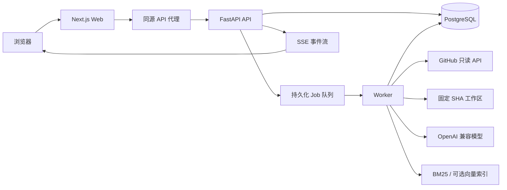
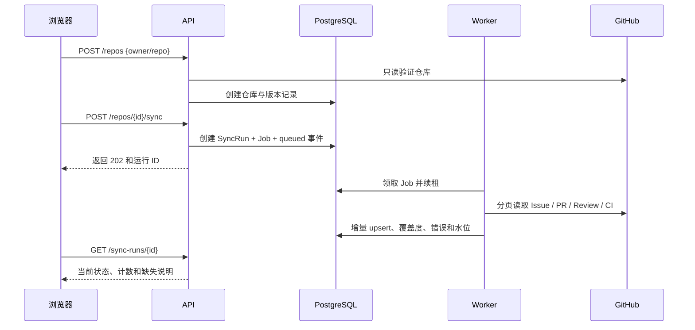

# DevFlow AI 项目流程详解

本文是面向开发者和维护者的项目流程说明。它解释一次请求从浏览器进入系统，到 API、数据库、Worker、GitHub、模型和前端展示之间如何流转，也说明每个阶段能做什么、不能做什么以及如何验证结果。

## 1. 项目解决什么问题

DevFlow AI 面向一个或多个 GitHub 仓库，把研发协作中分散的代码、Issue、PR、Review、CI、项目文档和历史经验整理成可核查的分析结果。

它提供四类能力：

1. **同步项目资料**：按时间窗口增量读取 GitHub 资源，记录同步覆盖度、跳过项和权限错误。
2. **生成研发分析**：围绕 PR、Issue、CI、仓库健康和知识问答创建一次可追踪运行。
3. **绑定证据**：每条结论都必须引用本次运行实际读取的证据，证据固定到版本、文件、行号或远端资源。
4. **受控协作**：发布检查、项目记忆、活动报告和操作草稿都通过审批或状态机推进；系统默认不直接写 GitHub。

工程师仍然拥有合并、发布、关闭 Issue 和执行外部写入的最终决定权。模型给出的建议不等同于 GitHub 权限、保护规则或生产发布结论。

## 2. 运行形态



### 2.1 进程职责

| 组件 | 主要职责 | 不应承担的工作 |
| --- | --- | --- |
| Web | 页面、表单、会话交互、SSE 展示 | 保存模型密钥、直接访问数据库、绕过 API 读 GitHub |
| API | 登录、参数校验、权限判断、事务、创建 Job、查询结果 | 在 HTTP 请求内执行完整同步或模型工作流 |
| Worker | 领取 Job、同步资源、执行分析、索引、生成报告、执行已批准草稿 | 绕过服务端开关直接写远端 |
| PostgreSQL | 用户、仓库、运行、事件、证据、审批和队列状态的权威来源 | 作为无上限原始日志文件仓库 |
| 文件存储 | Git 镜像、日志、快照、索引和备份 | 作为权限真相来源或静态公开目录 |
| GitHub 适配器 | 以最小权限读取仓库和 Actions 资料 | 允许模型任意选择凭据或 URL |
| 模型适配器 | 调用配置好的 OpenAI 兼容接口并校验结构化结果 | 决定权限、扩大证据范围或自动降级为离线结果 |

## 3. 目录与职责

```text
vibe/
├─ backend/                         # FastAPI、领域服务、Worker 和测试
│  ├─ app/api/routes/               # HTTP 路由：认证、仓库、运行、知识、平台能力
│  ├─ app/services/                 # 业务编排：同步、运行、记忆、草稿、仓库
│  ├─ app/agents/                   # Agent 循环、预算、PR 和专用分析器
│  ├─ app/tools/                    # 模型可调用的受控工具
│  ├─ app/integrations/github/      # GitHub API、只读适配和权限诊断
│  ├─ app/ingestion/                # CI 日志和外部资料的解析入口
│  ├─ app/workflows/                # LangGraph 工作流、节点和恢复约束
│  ├─ app/persistence/              # SQLAlchemy 模型、会话和数据库访问
│  ├─ migrations/                   # Alembic 迁移
│  └─ tests/                        # 后端单元、契约、集成和策略测试
├─ frontend/
│  ├─ src/app/                      # Next.js 页面、同源 API 代理和全局样式
│  ├─ src/components/               # 工作区壳层、目标选择、证据组件
│  ├─ src/lib/api/client.ts         # 浏览器统一 API 请求、超时和错误解析
│  ├─ tests/e2e/                    # 日常浏览器验收
│  └─ tests/flows/                  # 审批、取消、恢复和 CI 等独立流程验收
├─ contracts/                       # OpenAPI 和领域 Schema 自动导出物
├─ evals/                           # 固定案例、真实案例基线和评测结果
├─ fixtures/                        # 离线模型和测试数据
├─ infra/                           # Docker Compose、镜像和数据库服务
├─ scripts/                         # 启动、停止、迁移、备份、恢复和验收脚本
├─ docs/                            # 开发说明、ADR、阶段验收和本流程文档
└─ var/                             # 本地数据库记录、日志、工作区、备份和初始凭据
```

`var/`、`.env`、模型密钥、GitHub Token 和生成的索引不提交到 Git。`contracts/` 中的 JSON 由实际代码导出，不能手工修改后当作实现依据。

## 4. 从启动到登录

### 4.1 准备配置

首次准备由 `scripts/init_env.py` 创建 `.env` 和随机数据库密码。管理员初始凭据写入 `var/initial-admin.json`，仅供本地浏览器测试使用。

常用服务配置包括：

- `DATABASE_URL`：PostgreSQL 连接地址。
- `APP_ORIGIN`：默认 `http://localhost:3100`，用于 Origin 和 CSRF 校验。
- `GITHUB_READ_TOKEN`：可选的最小权限只读 Token。
- `LLM_BASE_URL`、`LLM_MODEL`、`LLM_API_KEY`：可选的 OpenAI 兼容模型配置。
- `STORAGE_ROOT`：固定 SHA 工作区、日志和索引的根目录。

管理员密码长度要求为 6–128 个字符。修改已有管理员密码使用 `set-admin-password` 命令；修改后该账户的已有会话会被撤销。

密钥只由后端读取，不经浏览器输入、不出现在 OpenAPI、不写入日志和错误消息。

### 4.2 启动服务

本地进程模式由 `scripts/start_local.ps1` 统一启动 API、Worker 和 Web，并把 PID、启动时间和日志写入 `var/`。停止时使用 `scripts/stop_local.ps1`，脚本只关闭自己记录且启动时间匹配的进程树。

```powershell
pnpm --dir frontend build
pwsh -NoProfile -File scripts/start_local.ps1
```

就绪检查：

1. API `http://127.0.0.1:8100/api/v1/health/ready` 返回成功。
2. Web `http://localhost:3100/login` 可以打开。
3. Worker 日志没有启动异常，首页“任务进程”显示在线。

Docker 模式使用独立 Compose 项目和数据库卷。切换模式前先停止另一种模式，不能使用 `down -v` 删除已有数据卷。

### 4.3 登录流程

1. 浏览器请求 `/`，未登录时由页面跳转到 `/login`。
2. 用户提交账户和密码，Web 通过同源 `/api/v1/auth/login` 发送请求。
3. API 校验密码、限流并设置会话 Cookie，同时设置 CSRF Cookie。
4. 后续写请求带 `Origin` 和 `X-CSRF-Token`；API 拒绝来源不匹配或 Token 缺失的请求。
5. 页面调用 `/auth/me` 恢复身份，再并行读取能力状态和最近模型探测记录。

登录失败只返回面向用户的错误，不回显密码校验细节。会话失效时页面统一跳回登录页。

## 5. 仓库接入与同步流程



同步的关键边界：

- 默认每种资源最多读取 4 页，关闭项默认回看 90 天，CI 默认回看 30 天。
- 达到页数或时间边界时标记 `partial`，不推进对应水位，下一轮可以继续。
- GitHub 403/429 会转换为可重试错误；权限不足不会被伪装成“没有数据”。
- 同一仓库已有活动同步时，重复请求复用活动运行；幂等键可防止客户端重试重复创建任务。
- 仓库禁用后不能创建新的同步或分析；已有历史数据仍可审阅。

同步完成后，仓库页展示资源计数、覆盖度、失败资源和最近更新时间。同步成功只表示资料读取完成，不表示分析结论正确。

## 6. 一次分析的完整流程

一次 PR、Issue、CI、仓库健康或知识问答都遵循同一条主线：

1. **创建会话**：会话绑定一个仓库，记录分析类型和用户问题。
2. **创建运行**：API 校验目标编号、输入长度、仓库状态和当前是否已有活动运行。
3. **排队返回**：数据库事务同时写入用户消息、Run、Job 和 `run.queued` 事件，HTTP 返回 `202`。
4. **固定版本**：Worker 读取目标当前版本，固定 PR head/base SHA 或当前默认分支 SHA。
5. **收集证据**：读取 diff、Review、Issue、CI、文件片段、知识库结果或权限诊断。
6. **执行 Agent**：模型只能调用服务端注入范围内的工具；每次工具调用记录输入摘要、结果摘要、耗时和证据 ID。
7. **校验输出**：Pydantic 校验结构化结果，检查引用是否属于本次运行、是否指向真实证据，并应用裁决规则。
8. **保存终态**：写入报告、助手消息、用量、运行终态和终态事件。
9. **前端恢复**：页面通过 SSE 接收安全的进度摘要，再读取权威结果；刷新页面不丢失运行状态。

### 6.1 PR 审查

PR 审查关注变更范围、风险、证据缺口和下一步验证。代码读取必须固定到本次运行的 SHA；如果分析期间 PR head 发生变化，报告标记为过时，不能继续当作当前版本结论。

### 6.2 Issue 分诊

Issue 分析输出分类、优先级、影响范围和建议行动。缺少复现步骤、环境或日志时，结果必须把它列为证据缺口，不能生成确定性根因。

### 6.3 CI 排障

CI 运行优先按 PR head SHA 匹配；用户指定 run ID 时还要校验 run 属于目标仓库和目标提交。多次 attempt 必须保留尝试编号，日志权限不足时显示 `unknown` 或明确的权限诊断，不把“读不到日志”解释为“没有失败”。

### 6.4 知识问答

知识问答先检索文档版本，再把候选片段和通道状态交给 Agent。引用固定到 document version 和片段定位；文档删除后即时过滤，旧报告仍保留当时引用的版本。

## 7. Agent、证据和预算

Agent 不是直接访问外部系统的脚本，而是受服务端约束的工具循环：

```text
规划问题 → 选择受控工具 → 获取工具结果 → 绑定证据
      ↑                                  ↓
      └────── 预算/状态/引用校验 ←───────┘
                         ↓
                  结构化最终报告
```

服务端负责：

- 注入当前用户、仓库、运行和固定 SHA，模型不能覆盖这些范围。
- 限制模型步骤、工具次数、单次结果大小和总字节数。
- 只允许声明过的工具，未知工具名直接失败。
- 在最终输出前验证 Schema、引用归属、URL 来源和证据状态。
- 达到预算时要求模型收束；仍无法形成合规结果则运行失败，并保留失败轨迹。

离线 fixture 只验证协议和实现链路，页面会明确标记“离线协议回放”。真实模型探测只发送合成输入；真实业务分析才会发送已授权仓库资料，并且需要单独配置模型与权限。

## 8. 工作流与审批

平台能力把“建议”和“外部改变”分开：

1. **发布检查**：聚合 PR、必需检查、CI 和仓库规则，输出允许、阻塞或未知，并列出证据。
2. **项目记忆**：从已完成运行中选择来源和支持证据，提交后进入待审批；只有批准且未过期的记忆参与后续上下文。
3. **活动报告**：按 UTC 时间窗口统计已同步事件，可下载 JSON；批准后才能作为 generated 文档进入知识库。
4. **操作草稿**：先生成目标、版本、正文和有效期，再审批，最后由独立 Job 执行。
5. **外部写回**：服务端开关、仓库白名单和最小写权限同时满足才允许执行；修订草稿会撤销旧批准。

写回的失败状态必须保留 `unknown` 语义。网络超时不能自动重发可能已经成功的请求，必须由人核查远端结果后再决定下一步。

## 9. 取消、恢复和一致性

- 运行取消是协作信号和状态转换，不保证已经发出的外部读取立即中断。
- Worker 使用租约和心跳；进程异常退出后，过期租约由恢复逻辑重新排队或标记失败。
- 同一会话同一时刻只允许一个活动运行，避免消息顺序和摘要互相覆盖。
- SSE 断开后，浏览器可以带 `Last-Event-ID` 或 `after` 重新读取事件；最终结果仍以数据库查询为准。
- 恢复不会重放已确认的外部写回；对于未知结果只保留待核查状态。

## 10. 日常操作路径

### 使用者路径

1. 登录工作空间。
2. 进入“仓库协作”，添加 `owner/repo` 并点击同步。
3. 进入仓库，创建分析会话，选择 PR、Issue、CI、健康检查或知识问答。
4. 查看运行进度；完成后按结论、风险、证据、缺口和建议阅读。
5. 需要协作时进入“工作流与审批”，先检查证据，再批准记忆、报告或操作草稿。
6. 只有确认目标、版本和正文后，才执行允许的外部操作。

### 维护者路径

```powershell
# 构建与启动
pnpm --dir frontend build
pwsh -NoProfile -File scripts/start_local.ps1

# 停止（保留数据库和文件）
pwsh -NoProfile -File scripts/stop_local.ps1

# 后端与前端检查
pwsh -NoProfile -File scripts/dev.ps1 test
pnpm --dir frontend typecheck
pnpm --dir frontend build
pnpm --dir frontend test:e2e
```

遇到“任务进程等待启动”先看 `var/worker.stderr.log`；遇到 403 先核对 `APP_ORIGIN`、CSRF 和 GitHub Token；遇到证据不足先检查同步覆盖度、Actions 权限和目标 SHA。

## 11. 测试与验收分层

| 层级 | 命令/位置 | 验证内容 |
| --- | --- | --- |
| 后端单元与契约 | `backend/.venv/Scripts/python.exe -m pytest -q` | 领域规则、API、策略、工具和数据访问 |
| 静态检查 | `ruff check`、`pnpm --dir frontend typecheck` | Python/TypeScript 类型和风格问题 |
| 前端构建 | `pnpm --dir frontend build` | Next.js 生产编译和路由类型 |
| 日常 E2E | `frontend/tests/e2e` | 登录、离线验证、仓库、平台页面、报告下载和移动端 |
| 独立流程 E2E | `frontend/tests/flows` | 审批/撤销、取消、租约恢复、CI head/attempt 选择 |
| 固定评测 | `scripts/evaluate.py`、`evals/` | 质量基线、证据支持和边界分类 |
| 恢复演练 | `scripts/backup_restore.py`、`scripts/verify_restore.py` | 数据库、文件和索引恢复后的可用性 |

验收时要区分三件事：功能链路通过、离线协议通过、模型质量通过。前两者不能替代真实模型的准确率评测。

## 12. 关键安全与边界

- 所有仓库读取都经过服务端身份和仓库范围校验。
- 浏览器永远不持有 GitHub 或模型密钥。
- 默认不执行目标仓库代码、不安装目标依赖、不自动合并或发布。
- 证据不足、权限不足、日志缺失和版本变化都必须显式呈现。
- 配置外部写回前，应使用专用测试仓库和最小权限 Token。
- 备份不包含 `.env` 和初始密码；恢复使用新数据库名和新存储目录，避免覆盖原数据。

更多接口、环境变量和阶段边界见 [开发与启动说明](development.md)、[完整设计契约](../README.md) 和 [平台验收记录](demos/platform-acceptance.md)。
